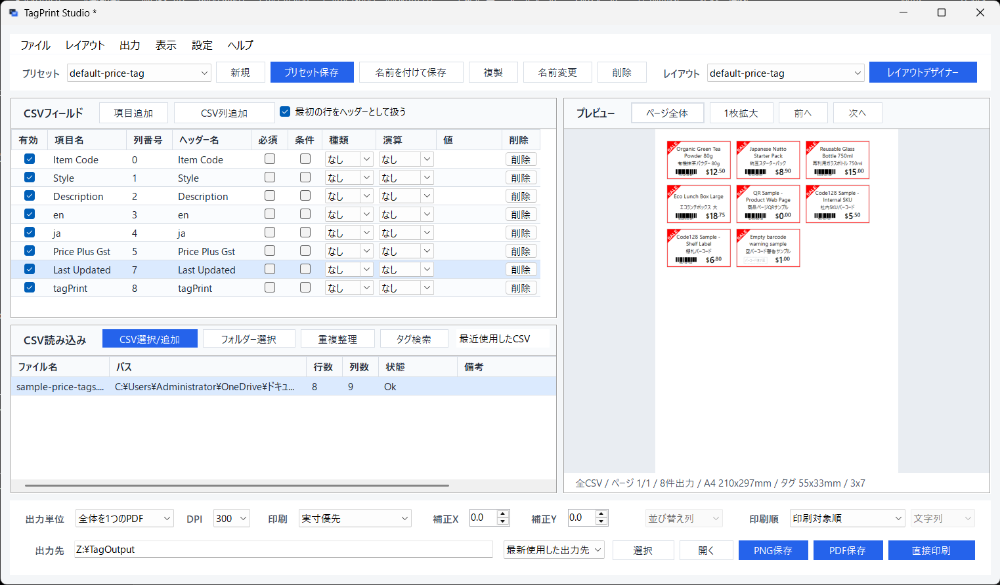
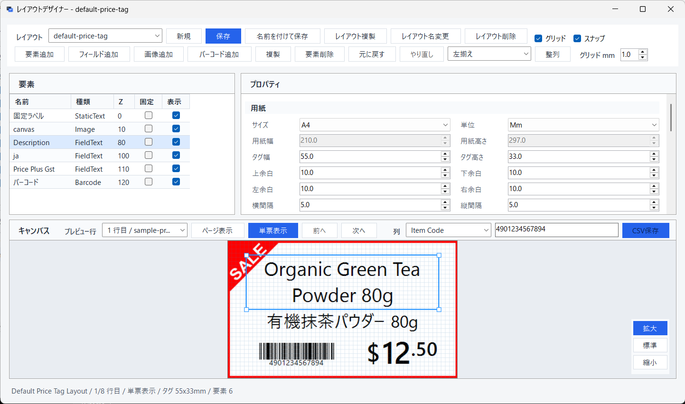
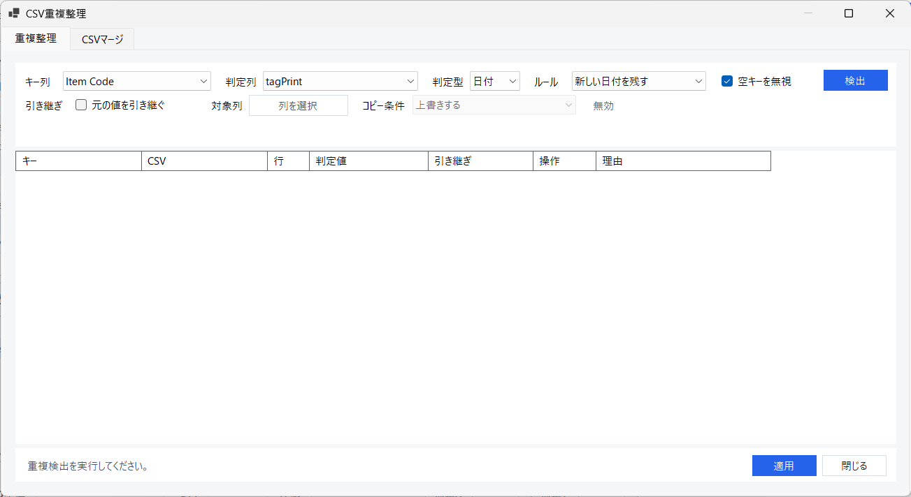
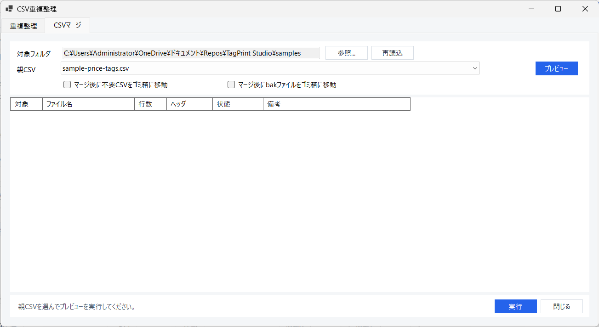

# TagPrint Studio

**TagPrint Studio v1.0.9** は、CSV データをもとに価格タグや商品ラベルを作成し、プレビュー、PDF/PNG 保存、直接印刷まで行える Windows デスクトップアプリです。

CSV フィールドの自動マッピング、レイアウト編集、印刷順の制御、印刷対象の確認、タグ検索、印刷キュー CSV 作成、CSV 重複整理、CSV マージ、バーコード/QR コード、日本語/英語 UI、設定バックアップ/インポート、バックアップファイル整理、クラッシュログ、アプリデータ保存場所の変更に対応しています。


## v1.0.9 の主な更新

- PDF/PNG 出力の安全性を改善しました。
  - 既存の出力ファイルを上書きする場合でも、キャンセルや失敗で元ファイルが失われにくい構造にしました。
  - 出力はまず一意な `.partial-*` ファイルへ書き込みます。
  - 既存ファイルを置き換える場合は一時バックアップを作成し、キャンセル/失敗時は復元します。
  - キャンセル時に削除するのは、その操作で新規作成されたファイルだけです。
- CSV 読み込みの再現性を改善しました。
  - 完全な空行を読み込み時に削除せず、物理的な空行として保持します。
  - 保存時も空行を空行として書き戻します。
  - 空行は印刷対象にはせず、列数不一致チェックの対象からも除外します。
- CSV 判定を改善しました。
  - 区切り文字判定を先頭 1 レコード依存から、先頭最大 20 レコードを使う方式に変更しました。
  - カンマ、タブ、セミコロンを、列数の安定性、出現レコード数、出現数、優先順位で判定します。
  - 引用符内の区切り文字は判定対象外です。
  - UTF-8 BOM、UTF-16 LE BOM、UTF-16 BE BOM、valid UTF-8、Shift_JIS fallback に対応しました。
- 設定バックアップと異常終了時の安全性を改善しました。
  - 設定バックアップ ZIP は一時ファイルへ作成し、成功後にだけ本来の ZIP へ置き換えます。
  - 既存バックアップ ZIP を新規作成前に削除しないようにしました。
  - 未処理例外を捕捉し、ユーザーへメッセージを表示し、アプリデータ配下の `logs` にクラッシュログを保存します。
- 保守性と配布性を改善しました。
  - cleanup 系ダイアログに残っていた直接 `L("日本語", "English")` 方式の文字列を共通ローカライズリソースへ移しました。
  - アプリ本体とテストプロジェクトを `.NET 8.0 Windows` ターゲットにし、LTS ベースで扱いやすくしました。
  - 実装で使用している `QRCoder` パッケージバージョン `1.8.0` にドキュメント表記を合わせました。
- README、リリースノート、英日マニュアルを v1.0.9 向けに更新しました。

## v1.0.7 の主な更新

- **タグファインダー** の日本語/英語UIを改善しました。
  - タグファインダーのラベル、ボタン、メッセージ、列見出しを共通ローカライズリソースへ統一しました。
  - 残っていた日本語UI文字列の文字化けを整理し、古い文字化けプリセット/レイアウトを起動時に検出する処理を維持しました。
  - **true のみ表示** ボタンの幅と文字サイズを調整し、日本語ラベルが収まりやすくなりました。
  - タグプレビュー見出しの不要な付加表示を削除しました。
- 印刷キューCSVの安全性を改善しました。
  - 同じ秒にキューCSVを作成した場合でも上書きしないよう、必要に応じて `-2`、`-3` などの連番を付けます。
  - タグファインダーからキューを作成するとき、先に親CSV側のフラグを保存し、親CSVの元行を通常の1枚目として扱えるようにしました。
  - 保存からキュー作成へ進む場合、CSVフラグ保存が重複しないようにしました。
- アプリデータ保存場所の管理をドキュメント化しました。
  - `layouts`、`presets`、`recent`、`settings` の保存先ルートを、設定から変更・表示・既定に戻せます。
- README、リリースノート、英日マニュアルを v1.0.7 向けに更新しました。

## v1.0.6 の主な更新

- メイン画面の **ページ全体プレビュー** のズーム操作を改善しました。
  - プレビュー領域内に `拡大`、`標準`、`縮小` ボタンを追加しました。
  - 拡大率に応じてページ全体プレビューを高解像度で再描画するようにし、拡大時のぼやけを軽減しました。
  - 拡大時はスクロールバーに加えて、手のひらドラッグで表示範囲を移動できます。
- アプリバージョンを v1.0.6 に更新しました。
- README、リリースノート、英日マニュアルを更新しました。

## v1.0.5 の主な更新

- CSV列追加、タグファインダーからの CSV 保存、レイアウトデザイナーの CSV プレビュー保存、重複整理、CSV マージのバックアップ形式を統一しました。
- 設定メニューに **バックアップファイル整理** を追加しました。
- タグファインダーのキュー運用と小型プレビューを改善しました。
- CSV マージのプレビュー安定性を改善しました。
- アプリバージョンを v1.0.5 に更新しました。

## v1.0.4 の主な更新

- 直接印刷、PDF 保存、PNG 保存に進捗ダイアログとキャンセルを追加しました。
- CSV フィールドに **CSV列追加** を追加しました。
- レイアウト要素の文字サイズを CSV 列から行ごとに指定できるようにしました。
- 設定メニューから大量印刷警告のしきい値を変更できるようにしました。

## v1.0.3 の主な更新

- 出力前の「印刷対象の確認」ダイアログを追加しました。
- タグファインダーに小型プレビュー、印刷枚数、印刷キュー CSV 作成を追加しました。
- 印刷順を読み込み順、Item Code 順、選択列順から選べるようにしました。

## 画面イメージ










## 主な機能

### CSV 読み込みとフィールド設定

- 1 つまたは複数の CSV を読み込み。
- フォルダー内の CSV をまとめて読み込み。
- 最近使用した CSV を再読み込み。
- 起動時 CSV / 起動時フォルダーを指定。
- 最初の行をヘッダーとして扱う設定。
- CSV ヘッダーからフィールド定義を自動生成。
- CSV フィールドから、読み込み済みすべての CSV に新しい列を追加。
- 必須、条件、種類、演算、値を指定して印刷対象を絞り込み。
- 日付値の編集中に `Ctrl + ;` で今日の日付を入力。
- 完全な空行を保持しつつ、印刷対象と列数不一致チェックから除外。
- UTF-8 BOM、UTF-16 LE BOM、UTF-16 BE BOM、valid UTF-8、Shift_JIS fallback を判定。
- カンマ、タブ、セミコロンを複数レコードから推定し、引用符内の区切り文字を無視。

### プリセットとレイアウト

- プリセットの新規作成、保存、名前を付けて保存、複製、名前変更、削除。
- レイアウトの新規作成、保存、名前を付けて保存、複製、名前変更、削除。
- 最後の 1 件や使用中レイアウトの削除を防ぐ保護。

### レイアウトデザイナー

- 用紙サイズ、タグサイズ、余白、間隔、行数/列数を編集。
- 固定テキスト、CSV フィールド、価格、画像、バーコード、QR コードを配置。
- テキスト要素の文字サイズを固定値、または CSV 列から行ごとに指定。
- 要素の移動、リサイズ、固定、表示切替、複製、削除、整列。
- グリッド、スナップ、グリッド間隔の設定。
- 単票表示とページ表示。
- メイン画面の出力単位やフィルター状態に応じた CSV 行でプレビュー。
- キャンバス上で CSV セル値を編集し、明示的に CSV 保存。
- テキスト要素をダブルクリックして直接編集。
- `Enter` で確定、`Shift + Enter` で改行、`Esc` でキャンセル。
- キャンバス右下の拡大、標準、縮小ボタンで表示領域を調整。

### バーコード / QR コード

対応種類:

- Code128
- EAN-13 / JAN-13
- QR Code

EAN-13 / JAN-13:

- 12 桁はチェックディジットを自動計算。
- 13 桁はチェックディジットを検証。
- 不正な値はプレビューや出力前チェックで警告。

QR Code 生成には `QRCoder` NuGet パッケージ version `1.8.0` を使用しています。

### プレビューと出力

- ページ全体プレビューと高解像度の 1 枚拡大プレビュー。
- ページ全体プレビューでは、プレビュー内のズームボタンとドラッグ移動に対応。
- ページ表示では前へ/次へがページ単位で移動。
- 1 枚拡大では前へ/次へがタグ単位で移動。
- 全 CSV を 1 つの PDF に保存。
- CSV ごとに PDF を保存。
- ページごと、または行ごとに PNG 保存。
- 直接印刷。
- 大量出力向けの進捗表示とキャンセル。
- PDF/PNG は一意な `.partial-*` 経由で保存し、既存ファイル上書き時は一時バックアップを使ってキャンセル/失敗時に復元。
- 実寸優先 / 印刷可能領域に合わせる の切り替え。
- プリンターごとの補正 X/Y を mm 単位で指定。
- 印刷順は読み込み順、Item Code 順、選択列順に対応。
- 出力前の印刷対象確認。
- PDF 保存後に保存先を開くチェックボックス付き完了ダイアログ。

### タグファインダー

- 読み込み済み CSV から選択項目で検索。
- 一致したすべての行を表示。
- 行ごとに対象チェックを切り替え。
- `tagPrint` など任意の保存列へ `true` / `false` を保存。
- 保存列が存在しない場合は、読み込み済みすべての CSV に列を追加。
- 保存、保存して次へ、キュー作成、キュー作成して次へ。
- `true` のみ表示。
- 検索後に自動的に対象へチェック。
- 小型プレビューの表示切り替え。
- `tagPrintOrder` などの順番列で、印刷対象にした順序を保持可能。
- `trueのみ` 一覧からダブルクリックで検索値へ戻し、対象行を確認しながら操作可能。
- 小型プレビューから現在のタグをレイアウトデザイナーで開くことが可能。
- 印刷枚数 2 以上で印刷キュー CSV を作成。
- キュー CSV をすべて削除。
- キュー CSV は日時付きファイル名で作成され、同名ファイルがある場合は連番を付けて上書きを防止。

### CSV 重複整理と CSV マージ

- 複数 CSV にまたがる重複行を検出。
- キー列、判定列、判定型、ルールを指定。
- 判定型は日付、数値、文字列。
- 新しい日付、古い日付、最大値、最小値、先勝ち、後勝ちなどに対応。
- 空キーを無視。
- 削除対象行から残す行へ、指定列の値を引き継ぎ。
- 残す側が空ならコピー / 上書きする を選択。
- 検出結果は列ヘッダークリックで並び替え可能。
- 適用後もウィンドウを閉じず、結果を確認可能。
- 同一フォルダー内の複数 CSV を親 CSV にマージ。
- マージ後の不要 CSV や `.bak` ファイルをゴミ箱へ移動可能。
- キュー CSV は重複整理と CSV マージの対象外。
- 列数の異なる別 CSV が同じフォルダーにあっても、親 CSV が読めればプレビュー可能。

### 設定と安全性

- 日本語 / 英語 UI 切り替え。
- アプリデータ保存場所の変更、表示、既定へのリセット。
- 起動時 CSV / 起動時フォルダー。
- 最近使用した CSV / 出力先。
- 最後に使用したプリセット、レイアウト、出力先、DPI、出力形式、印刷設定。
- `layouts`、`presets`、`recent`、`settings` を ZIP にまとめる設定バックアップ。
- 一時 ZIP 経由の安全な設定バックアップ作成。
- バックアップ ZIP から設定をインポート。
- `*.csv.bak-*` を整理するバックアップファイル整理。
- 設定ファイルの場所を開く。
- 出力前に印刷対象を確認する設定。
- 予期しないエラー発生時のクラッシュログ保存。

## サンプル CSV

サンプルデータは次のフォルダーにあります。

```text
samples/
```

含まれるサンプル:

```text
samples/sample-price-tags.csv
samples/sample-frame.png
```

## ドキュメント

- 英語マニュアル: [docs/MANUAL.md](docs/MANUAL.md)
- 日本語マニュアル: [docs/MANUAL.ja.md](docs/MANUAL.ja.md)
- リリースノート: [RELEASE_NOTES.md](RELEASE_NOTES.md)

## プロジェクト構成

```text
TagPrint Studio/
├─ Models/
├─ Services/
├─ UI/
├─ Resources/
├─ samples/
├─ docs/
│  └─ images/
├─ TagPrintStudio.csproj
├─ README.md
├─ README.ja.md
└─ RELEASE_NOTES.md
```

重要な領域:

```text
UI/MainForm*.cs
UI/LayoutDesignerForm*.cs
UI/TagFinderDialog.cs
UI/CsvDuplicateCleanupDialog.cs
UI/CsvMergeDialog.cs
UI/BackupCleanupDialog.cs
Services/CsvLoaderService.cs
Services/OutputService.cs
Services/SettingsArchiveService.cs
Services/CrashLogService.cs
Services/PreviewRenderService*.cs
Services/PreflightCheckService.cs
Services/PresetLayoutServices.cs
Services/PrintTargetSummaryService.cs
Services/TagFinderService.cs
Services/LocalizationResources*.cs
```

## ビルド

必要環境:

- Windows
- .NET 8 SDK (LTS)、または .NET 8 targeting pack を含む新しい SDK
- Windows Forms 対応

復元とビルド:

```powershell
dotnet restore
dotnet build
```

テスト:

```powershell
dotnet test
```

Windows x64 向け自己完結 single-file 実行ファイルとして publish:

```powershell
dotnet publish "TagPrintStudio.csproj" -c Release -r win-x64 --self-contained true -p:PublishSingleFile=true -p:UseAppHost=true
```

生成先:

```text
bin/Release/net8.0-windows/win-x64/publish/
```

## NuGet パッケージ

```xml
<PackageReference Include="QRCoder" Version="1.8.0" />
```

## バージョン

現在のバージョン: **v1.0.9**
