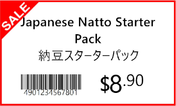
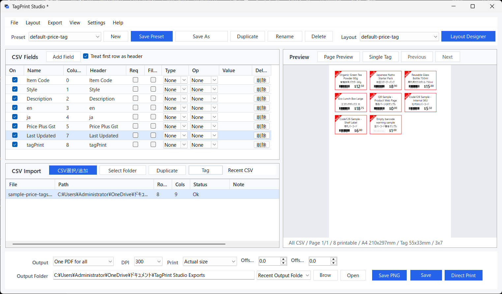
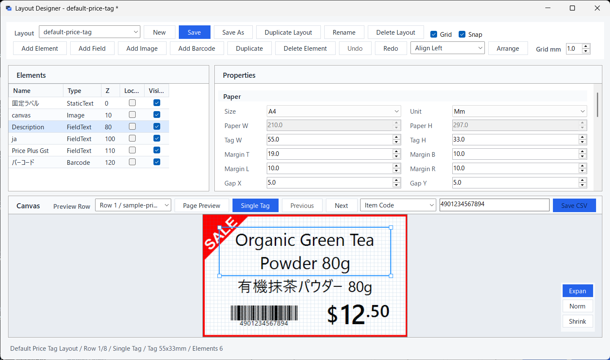
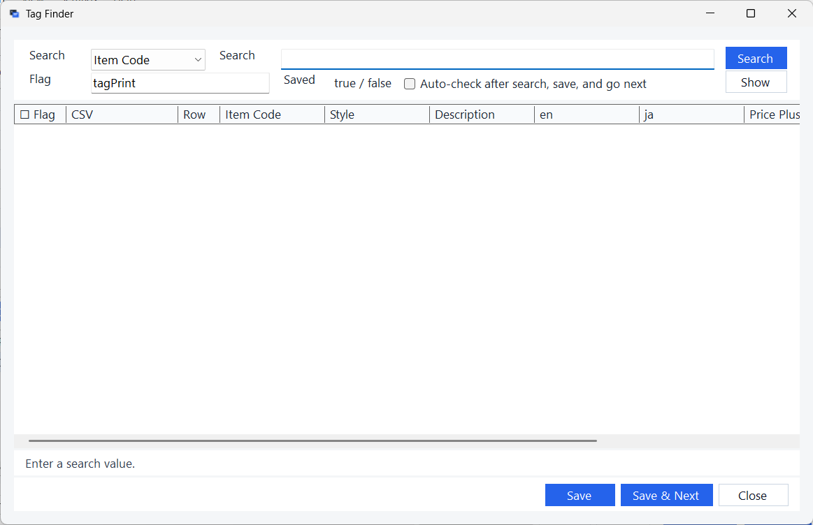
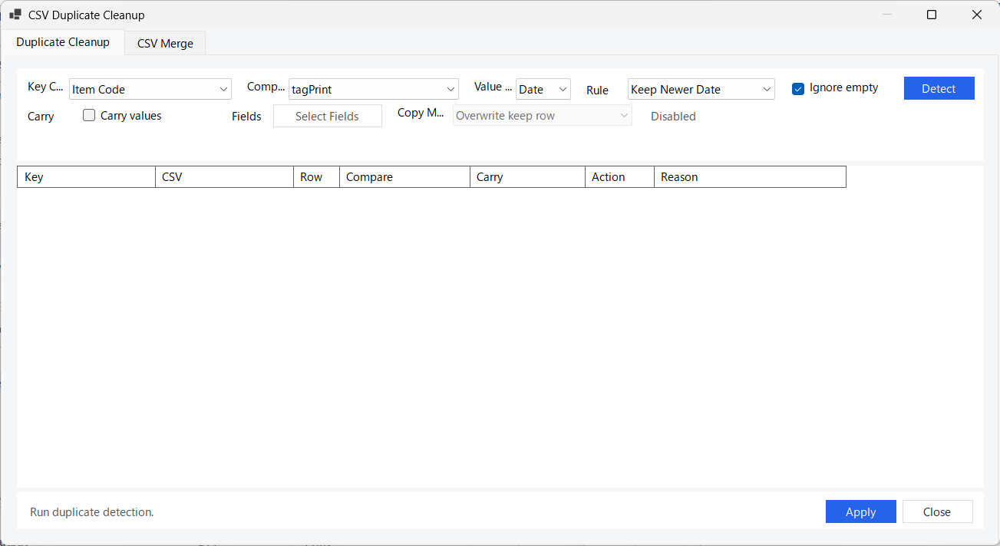

# TagPrint Studio

**TagPrint Studio v1.0.6** is a Windows desktop application for designing, previewing, exporting, and printing price tags and product labels from CSV data.

It supports CSV-based field mapping, layout editing, PDF/PNG output, direct printing, print order control, print target confirmation, duplicate cleanup, CSV merging, tag searching, print queue CSV creation, barcode/QR code elements, Japanese/English UI localization, settings backup/import, and backup cleanup.



## What's New in v1.0.6

- Improved **Page Preview** zooming in the main window.
  - Added `Expand`, `Normal`, and `Shrink` controls inside the preview area for page preview.
  - Page preview now rerenders at higher resolution as zoom increases, reducing blur during close inspection.
  - Added hand-pan dragging so the zoomed page can be moved by dragging, in addition to the scroll bars.
- Updated version metadata to v1.0.6.
- Updated README files, release notes, and English/Japanese manuals.

## What's New in v1.0.5

- Unified CSV backup naming across CSV column add, Tag Finder CSV save, Layout Designer CSV preview save, duplicate cleanup, and CSV merge.
  - CSV backups now use timestamped names such as `products.csv.bak-20260608-142530`.
  - Backup Cleanup can now manage those backup files consistently.
- Added **Backup File Cleanup** under the Settings menu.
  - Preview old or excess `*.csv.bak-*` files.
  - Clean them up by retention days and maximum backup count per CSV.
  - Moves deleted backups to the Recycle Bin.
- Improved Tag Finder workflows.
  - Added **Open in Layout Designer** from the small tag preview.
  - When **Show true only** is active, queue creation now targets the active row instead of every checked row in the list.
  - Save and queue actions reset print quantity back to `1`.
  - Closing Tag Finder now checks for unused queue CSV files and offers cleanup.
- Improved CSV merge preview stability.
  - Preview no longer fails just because another CSV in the same folder has a different column count.
  - Merge eligibility is now based on whether the file can be loaded and whether its header matches the selected parent CSV.
- Updated version metadata to v1.0.5.
- Rebuilt README files, release notes, and English/Japanese manuals for the current behavior.

## What's New in v1.0.4

- Added progress dialogs for direct print, PDF export, and PNG export.
- Added cancel support for long-running PDF/PNG output and direct print.
- PDF/PNG output now writes through `.partial` files and removes incomplete output when canceled.
- Direct print now renders one page at a time and reports page-level rendering failures with page numbers.
- Added **Add CSV Column** to append a new column to every loaded CSV file, including headers, with CSV backups.
- Layout text elements can now use a CSV field as the font-size source for row-specific tag text sizing.
- Added configurable large print warnings from the Settings menu, including the current threshold in the menu label.
- Added service tests for lazy page generation, page sorting behavior, empty output, and canceled PNG cleanup.

## What's New in v1.0.3

- Added a print target confirmation dialog before output.
  - Shows CSV names, row counts, tag counts, pages, and print order.
  - Allows searching the ordered print list and jumping to the matching row.
  - Can be enabled or disabled from the Settings menu.
- Improved Tag Finder for practical print preparation.
  - Added a small tag preview panel with a persistent preview on/off option.
  - Added print quantity handling.
  - When quantity is 2 or more, an additional `print_queue_yyyyMMdd_HHmmss.csv` is created in the parent CSV folder.
  - Queue CSV rows are generated as `quantity - 1`, so the original selected row plus queue rows match the requested total.
  - Queue CSV files can be deleted from Tag Finder or from the main CSV list context menu.
- Added and refined print ordering.
  - Supports load order, Item Code order, and selected-column order.
- Refactored print target summary and Tag Finder search/update logic into services.
- Rebuilt README, release notes, and manuals for the current feature set.

## Screenshots









## Main Features

### CSV Import and Field Mapping

- Load one or more CSV files.
- Load every CSV in a selected folder.
- Reopen recently used CSV files.
- Configure startup CSV and startup folder.
- Detect and preserve common encodings such as UTF-8 BOM and Shift_JIS.
- Treat the first row as a header.
- Automatically create field definitions from CSV headers.
- Add a new CSV column to every loaded CSV file from the CSV Fields area.
- Configure required fields, print conditions, value types, operators, and values.
- Use `Ctrl + ;` to insert today's date when editing date values in the CSV field table.

### Presets and Layouts

- Create, save, save as, duplicate, rename, and delete presets.
- Create, save, save as, duplicate, rename, and delete layouts.
- Protected deletion prevents removing the last layout/preset or layouts currently in use.

### Layout Designer

- Edit paper size, tag size, margins, gaps, and grid rows/columns.
- Add static text, CSV field text, price values, images, barcodes, and QR codes.
- Set text font size from a fixed value or from a CSV field, with min/max limits.
- Move, resize, lock, hide, duplicate, delete, and arrange elements.
- Use grid, snap, and grid-size controls.
- Preview a single tag or a full page.
- Select preview CSV rows supplied by the main window's current output scope and filters.
- Edit CSV cell values from the canvas toolbar and save them explicitly.
- Double-click text to edit directly on the canvas.
- `Enter` applies text edits, `Shift + Enter` inserts a line break, and `Esc` cancels.
- Use canvas area controls to expand, reset, or shrink the visible canvas area.

### Barcode and QR Code Support

Supported types:

- Code128
- EAN-13 / JAN-13
- QR Code

EAN-13 / JAN-13 behavior:

- 12-digit values receive a calculated check digit.
- 13-digit values are validated.
- Invalid values are reported by preview and preflight checks.

QR Code generation uses the `QRCoder` NuGet package.

### Preview and Output

- Page preview and high-resolution single-tag preview.
- Page preview supports in-panel zoom controls and drag panning when zoomed.
- Previous/Next moves by page in page preview and by tag in single-tag preview.
- Output all printable rows into one PDF.
- Output separate PDF files per CSV.
- Output individual PNG files per row.
- Direct print.
- Progress and cancel dialogs for long-running output.
- Atomic PDF/PNG writes through `.partial` files with cleanup on cancellation.
- Actual-size printing or fit-to-printable-area scaling.
- Printer-specific X/Y correction in millimeters.
- Print order: load order, Item Code order, or selected-column order.
- Optional print target confirmation dialog before output.
- PDF save completion dialog can open the output folder and remembers the checkbox state.

### Tag Finder

- Search loaded CSV files by a selected field.
- Show all matching rows.
- Mark individual rows with a save column such as `tagPrint`.
- Add the save column to all loaded CSV files to prevent column-count mismatch.
- Save, Save & Next, Queue, and Queue & Next workflows.
- Show only rows whose save column is `true`.
- Automatically check matching rows after search.
- Optional small tag preview.
- Optional order column such as `tagPrintOrder` to preserve the order rows were marked for output.
- Double-clicking a row in **Show true only** can push that row's selected search value back into the search box.
- The small preview can open the current row directly in Layout Designer.
- Print quantity support with queue CSV creation.
- Delete all queue CSV files from Tag Finder.

### CSV Duplicate Cleanup and Merge

- Detect duplicate rows across loaded CSV files.
- Choose key column, compare column, value type, and keep rule.
- Supported value types: date, number, string.
- Keep newest/oldest date, largest/smallest value, first row, or last row.
- Ignore empty keys.
- Copy selected values from rows marked for deletion into the kept row.
- Choose whether to copy only when the kept row is empty or overwrite.
- Sort detection results by clicking column headers.
- Apply cleanup without closing the window.
- Merge multiple CSV files in one folder into a selected parent CSV.
- Optionally move merged source CSVs and generated `.bak` files to the Recycle Bin.
- Merge preview ignores queue CSV files and stays usable even when other CSV files in the folder have different column counts.

### Settings

- Japanese/English UI language.
- Startup CSV and startup folder.
- Recent CSV and recent output folders.
- Last used preset, layout, output folder, DPI, output format, print mode, and related output settings.
- Settings backup ZIP containing `layouts`, `presets`, `recent`, and `settings`.
- Settings import from backup ZIP.
- Backup file cleanup for timestamped CSV backups, with retention-based preview and Recycle Bin cleanup.
- Open settings file location.
- Toggle print target confirmation.

## Sample CSV

Sample data is available under:

```text
samples/
```

## Documentation

- English manual: [docs/MANUAL.md](docs/MANUAL.md)
- Japanese manual: [docs/MANUAL.ja.md](docs/MANUAL.ja.md)
- Release notes: [RELEASE_NOTES.md](RELEASE_NOTES.md)

## Project Structure

```text
TagPrint Studio/
├─ Models/
├─ Services/
├─ UI/
├─ Resources/
├─ samples/
├─ docs/
│  └─ images/
├─ TagPrintStudio.csproj
├─ README.md
├─ README.ja.md
└─ RELEASE_NOTES.md
```

Important areas:

```text
UI/MainForm*.cs
UI/LayoutDesignerForm*.cs
UI/TagFinderDialog.cs
UI/CsvDuplicateCleanupDialog.cs
Services/PreviewRenderService*.cs
Services/PreflightCheckService.cs
Services/PresetLayoutServices.cs
Services/PrintTargetSummaryService.cs
Services/TagFinderService.cs
Services/LocalizationResources*.cs
```

## Build

Requirements:

- Windows
- .NET 10 SDK
- Windows Forms support

Restore and build:

```powershell
dotnet restore
dotnet build
```

Run tests:

```powershell
dotnet test
```

Publish as a self-contained single-file Windows x64 executable:

```powershell
dotnet publish "TagPrintStudio.csproj" -c Release -r win-x64 --self-contained true -p:PublishSingleFile=true -p:UseAppHost=true
```

The published executable is generated under:

```text
bin/Release/net10.0-windows/win-x64/publish/
```

## NuGet Packages

```xml
<PackageReference Include="QRCoder" Version="1.6.0" />
```

## Version

Current version: **v1.0.6**
