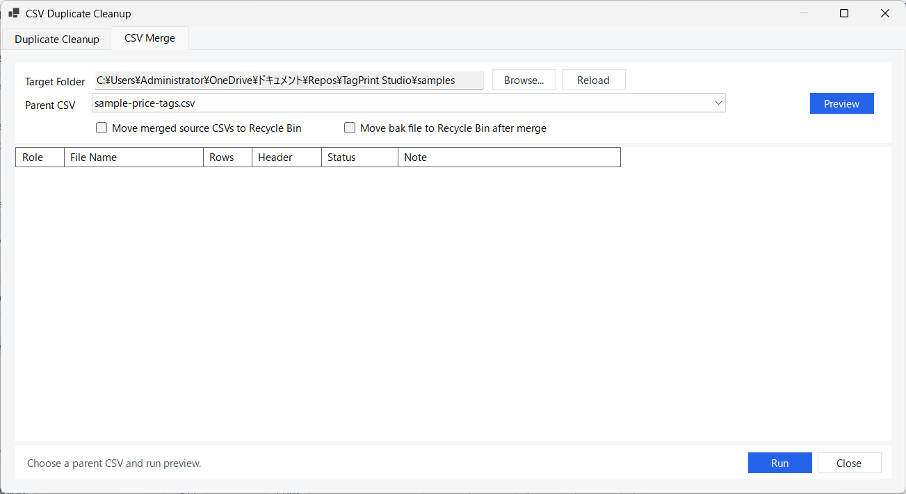

# TagPrint Studio

**TagPrint Studio v1.1.1** is a Windows desktop application for designing, previewing, exporting, and printing price tags and product labels from CSV data.

It supports CSV-based field mapping, layout editing, selectable PDF rendering, PDF/PNG output, direct printing, print order control, print target confirmation, duplicate cleanup, CSV merging, tag searching, print queue CSV creation, barcode/QR code elements, Japanese/English UI localization, settings backup/import, backup cleanup, crash logging, and custom app data storage locations.


## What's New in v1.1.1

- Improved Tag Finder safety and release readiness.
  - Added **Clear All Print Targets** to clear the print target column for all loaded CSV files, including queue CSV files.
  - The bulk clear action now shows a confirmation dialog with the loaded CSV count and target row count before saving.
  - When **Show True Only** is active, clearing all print targets now refreshes the list to the natural empty state.
  - The Tag Finder minimum width was widened so the new left-side action and existing right-side actions fit more reliably.
- Improved Layout Designer text editing.
  - The canvas text editor right-click menu now includes lowercase, uppercase, and title-style conversions.
  - Undo/Redo now covers committed canvas text edits more consistently after applying text with `Enter`.
- Updated version metadata, README files, release notes, and English/Japanese manuals for v1.1.1.
- Documented the release packaging reminder to exclude local Visual Studio `.vs` folders such as `docs/.vs`.

## What's New in v1.1.0

- Added selectable PDF rendering.
  - **Raster** keeps the existing compatibility-focused image-based PDF output.
  - **Vector Text** uses PDFsharp to keep the rendered page background compatible while adding selectable vector text for text, field, and price elements.
  - The Layout Designer font list now marks fonts that can be embedded in Vector Text PDFs and indicates the embedded fallback font when direct embedding is not available.
  - Output preflight shows element-level warnings when Vector Text PDF output must substitute a layout font.
- Improved CSV loading scalability.
  - CSV content is parsed from readers instead of loading the entire file text into memory up front.
  - A configurable maximum data-row limit is applied per CSV file.
  - Preview rows sent to the Layout Designer and Tag Finder are capped by a preview-row limit.
  - CSV load limits can be changed from the Settings menu.
  - The existing 100 MB per-file guard remains in place.
- Updated version metadata, package lock, README files, release notes, and manuals for v1.1.0.

## What's New in v1.0.9

- Improved output safety for PDF/PNG export.
  - Existing output files are no longer left vulnerable during cancel/failure paths.
  - Output is written to unique `.partial-*` files first.
  - If an existing output file must be replaced, it is temporarily backed up and restored if the operation is canceled or fails.
  - On cancellation, only files newly created by the canceled operation are removed.
- Improved CSV loading fidelity.
  - Blank physical CSV rows are preserved instead of being silently removed.
  - Blank rows are kept when saving CSV data back to disk, but they are not treated as printable rows.
  - Blank rows are excluded from column-count mismatch checks so intentional spacing in source CSV files does not cause false errors.
- Improved CSV detection.
  - Delimiter detection now checks up to the first 20 records instead of relying only on the first record.
  - Comma, tab, and semicolon candidates are scored by consistency, usage count, and priority.
  - Delimiters inside quoted values are ignored during detection.
  - UTF-16 LE and UTF-16 BE BOM encoded CSV files are now detected in addition to UTF-8 BOM, valid UTF-8, and Shift_JIS fallback.
- Improved settings and crash resilience.
  - Settings backup ZIP creation now writes to a temporary file first, then replaces the final ZIP only after successful creation.
  - Existing backup ZIP files are no longer deleted before the new ZIP has been completed.
  - App-level unhandled exception handlers now show an error message and save crash logs under the app data `logs` folder.
- Improved maintainability and deployment.
  - Remaining direct two-language UI strings in cleanup dialogs were moved to shared localization resources.
  - The application and test projects now target `.NET 8.0 Windows` for LTS-friendly development, CI, and distribution.
  - Documentation now matches the implemented `QRCoder` package version `1.8.0`.
- Updated README files, release notes, and English/Japanese manuals for v1.0.9.

## What's New in v1.0.7

- Polished the **Tag Finder** Japanese/English UI.
  - Moved Tag Finder labels, buttons, messages, and column headers to the shared localization resource system.
  - Fixed remaining garbled Japanese UI text and kept startup checks for older mojibake preset/layout files.
  - Adjusted the **Show True Only** button width and font size so the Japanese label fits reliably.
  - Cleaned the Tag Finder preview title so it no longer shows unnecessary suffix text.
- Improved print queue CSV safety.
  - Queue CSV files now avoid overwriting same-second files by adding suffixes such as `-2`, `-3`, and so on when needed.
  - Queue creation from Tag Finder saves the parent CSV flags first, so the original row remains the first normal copy.
  - Save-to-queue flow avoids duplicate CSV flag saves.
- Documented app data storage location management.
  - Settings can change, open, or reset the app data root used for `layouts`, `presets`, `recent`, and `settings`.
- Updated README files, release notes, and English/Japanese manuals for v1.0.7.

## What's New in v1.0.6

- Improved **Page Preview** zooming in the main window.
  - Added `Expand`, `Normal`, and `Shrink` controls inside the preview area for page preview.
  - Page preview now rerenders at higher resolution as zoom increases, reducing blur during close inspection.
  - Added hand-pan dragging so the zoomed page can be moved by dragging, in addition to the scroll bars.
- Updated version metadata to v1.0.6.
- Updated README files, release notes, and English/Japanese manuals.

## What's New in v1.0.5

- Unified CSV backup naming across CSV column add, Tag Finder CSV save, Layout Designer CSV preview save, duplicate cleanup, and CSV merge.
- Added **Backup File Cleanup** under the Settings menu.
- Improved Tag Finder queue and small-preview workflows.
- Improved CSV merge preview stability.
- Updated version metadata to v1.0.5.

## What's New in v1.0.4

- Added progress dialogs and cancel support for direct print, PDF export, and PNG export.
- Added **Add CSV Column** to append a new column to every loaded CSV file.
- Added row-specific CSV-driven font-size support for layout text elements.
- Added configurable large print warnings from the Settings menu.

## What's New in v1.0.3

- Added an optional print target confirmation dialog before output.
- Added Tag Finder small preview, print quantity, and print queue CSV creation.
- Added print ordering by load order, Item Code, or selected column.

## Screenshots




## Main Features

### CSV Import and Field Mapping

- Load one or more CSV files.
- Load every CSV in a selected folder.
- Reopen recently used CSV files.
- Configure startup CSV and startup folder.
- Treat the first row as a header.
- Automatically create field definitions from CSV headers.
- Add a new CSV column to every loaded CSV file from the CSV Fields area.
- Configure required fields, print conditions, value types, operators, and values.
- Use `Ctrl + ;` to insert today's date when editing date values in the CSV field table.
- Preserve blank physical CSV rows while excluding them from printing and column-count mismatch checks.
- Detect UTF-8 BOM, UTF-16 LE BOM, UTF-16 BE BOM, valid UTF-8, and Shift_JIS fallback.
- Detect comma, tab, or semicolon delimiters from multiple leading records while ignoring quoted delimiters.
- Stream CSV parsing from readers and enforce a maximum data-row limit per file.
- Configure CSV maximum data rows and preview row limits from the Settings menu.

### Presets and Layouts

- Create, save, save as, duplicate, rename, and delete presets.
- Create, save, save as, duplicate, rename, and delete layouts.
- Protected deletion prevents removing the last layout/preset or layouts currently in use.

### Layout Designer

- Edit paper size, tag size, margins, gaps, and grid rows/columns.
- Add static text, CSV field text, price values, images, barcodes, and QR codes.
- Set text font size from a fixed value or from a CSV field, with min/max limits.
- Move, resize, lock, hide, duplicate, delete, and arrange elements.
- Use grid, snap, and grid-size controls.
- Preview a single tag or a full page.
- Select preview CSV rows supplied by the main window's current output scope and filters.
- Edit CSV cell values from the canvas toolbar and save them explicitly.
- Double-click text to edit directly on the canvas.
- `Enter` applies text edits, `Shift + Enter` inserts a line break, and `Esc` cancels.
- Use the direct text editor context menu to convert text to lowercase, uppercase, or title style.
- Undo/Redo can revert committed canvas text edits.
- Use canvas area controls to expand, reset, or shrink the visible canvas area.

### Barcode and QR Code Support

Supported types:

- Code128
- EAN-13 / JAN-13
- QR Code

EAN-13 / JAN-13 behavior:

- 12-digit values receive a calculated check digit.
- 13-digit values are validated.
- Invalid values are reported by preview and preflight checks.

QR Code generation uses the `QRCoder` NuGet package version `1.8.0`.

### Preview and Output

- Page preview and high-resolution single-tag preview.
- Page preview supports in-panel zoom controls and drag panning when zoomed.
- Previous/Next moves by page in page preview and by tag in single-tag preview.
- Output all printable rows into one PDF.
- Output separate PDF files per CSV.
- Choose PDF rendering mode: Raster, or Vector Text for selectable text overlay.
- Vector Text PDFs embed compatible selected fonts directly when possible; some Windows collection fonts can be substituted with a safe embeddable fallback and are reported by preflight.
- Output PNG files per page or per row.
- Direct print.
- Progress and cancel dialogs for long-running output.
- Safer PDF/PNG output transactions using unique `.partial-*` files, temporary backups for overwritten existing files, restore-on-failure, and cleanup of only newly created canceled output.
- Actual-size printing or fit-to-printable-area scaling.
- Printer-specific X/Y correction in millimeters.
- Print order: load order, Item Code order, or selected-column order.
- Optional print target confirmation dialog before output.
- PDF save completion dialog can open the output folder and remembers the checkbox state.

### Tag Finder

- Search loaded CSV files by a selected field.
- Show all matching rows.
- Mark individual rows with a save column such as `tagPrint`.
- Add the save column to all loaded CSV files to prevent column-count mismatch.
- Save, Save & Next, Queue, and Queue & Next workflows.
- Show only rows whose save column is `true`.
- Automatically check matching rows after search.
- Optional small tag preview.
- Optional order column such as `tagPrintOrder` to preserve the order rows were marked for output.
- Double-clicking a row in **Show true only** can push that row's selected search value back into the search box.
- The small preview can open the current row directly in Layout Designer.
- Print quantity support with queue CSV creation.
- Delete all queue CSV files from Tag Finder.
- Clear all print targets across loaded CSV files, including queue CSV files, with confirmation.
- Queue CSV files use timestamped names and automatically add numeric suffixes when needed to avoid overwriting existing queue files.

### CSV Duplicate Cleanup and Merge

- Detect duplicate rows across loaded CSV files.
- Choose key column, compare column, value type, and keep rule.
- Supported value types: date, number, string.
- Keep newest/oldest date, largest/smallest value, first row, or last row.
- Ignore empty keys.
- Copy selected values from rows marked for deletion into the kept row.
- Choose whether to copy only when the kept row is empty or overwrite.
- Sort detection results by clicking column headers.
- Apply cleanup without closing the window.
- Merge multiple CSV files in one folder into a selected parent CSV.
- Optionally move merged source CSVs and generated `.bak` files to the Recycle Bin.
- Merge preview ignores queue CSV files and stays usable even when other CSV files in the folder have different column counts.

### Settings and Safety

- Japanese/English UI language.
- Change, open, or reset the app data storage location.
- Startup CSV and startup folder.
- Recent CSV and recent output folders.
- Last used preset, layout, output folder, DPI, output format, print mode, and related output settings.
- CSV maximum data-row and preview-row limits.
- Settings backup ZIP containing `layouts`, `presets`, `recent`, and `settings`.
- Atomic settings backup creation through a temporary ZIP before final replacement.
- Settings import from backup ZIP.
- Backup file cleanup for timestamped CSV backups, with retention settings, preview, settings-only save, and Recycle Bin cleanup.
- Open settings file location.
- Toggle print target confirmation.
- Crash logs under the app data `logs` folder for unexpected application errors.

## Sample CSV

Sample data is available under:

```text
samples/
```

Included sample assets:

```text
samples/sample-price-tags.csv
samples/sample-frame.png
```

## Documentation

- English manual: [docs/MANUAL.md](docs/MANUAL.md)
- Japanese manual: [docs/MANUAL.ja.md](docs/MANUAL.ja.md)
- Release notes: [RELEASE_NOTES.md](RELEASE_NOTES.md)

## Project Structure

```text
TagPrint Studio/
├─ Models/
├─ Services/
├─ UI/
├─ Resources/
├─ samples/
├─ docs/
│  └─ images/
├─ TagPrintStudio.csproj
├─ README.md
├─ README.ja.md
└─ RELEASE_NOTES.md
```

Important areas:

```text
UI/MainForm*.cs
UI/LayoutDesignerForm*.cs
UI/TagFinderDialog.cs
UI/CsvDuplicateCleanupDialog.cs
UI/CsvMergeDialog.cs
UI/BackupCleanupDialog.cs
Services/CsvLoaderService.cs
Services/OutputService.cs
Services/SettingsArchiveService.cs
Services/CrashLogService.cs
Services/PreviewRenderService*.cs
Services/PreflightCheckService.cs
Services/PresetLayoutServices.cs
Services/PrintTargetSummaryService.cs
Services/TagFinderService.cs
Services/LocalizationResources*.cs
```

## Build

Requirements:

- Windows
- .NET 8 SDK (LTS) or newer SDK with the .NET 8 targeting pack
- Windows Forms support

Restore and build:

```powershell
dotnet restore
dotnet build
```

Run tests:

```powershell
dotnet test
```

Publish as a self-contained single-file Windows x64 executable:

```powershell
dotnet publish "TagPrintStudio.csproj" -c Release -r win-x64 --self-contained true -p:PublishSingleFile=true -p:UseAppHost=true
```

The published executable is generated under:

```text
bin/Release/net8.0-windows/win-x64/publish/
```

## NuGet Packages

```xml
<PackageReference Include="PDFsharp" Version="6.2.2" />
<PackageReference Include="QRCoder" Version="1.8.0" />
```

## Version

Current version: **v1.1.1**
