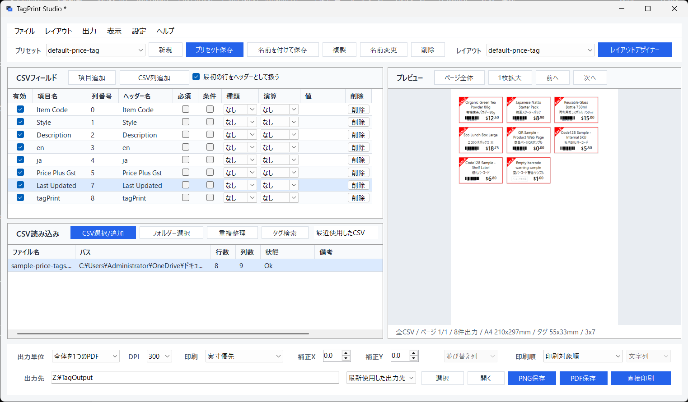
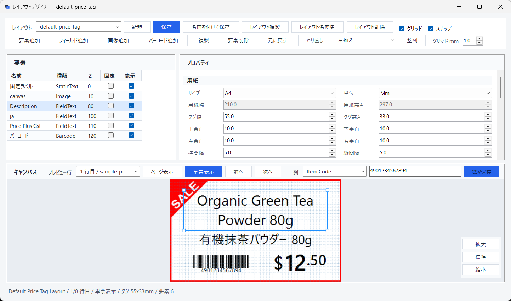
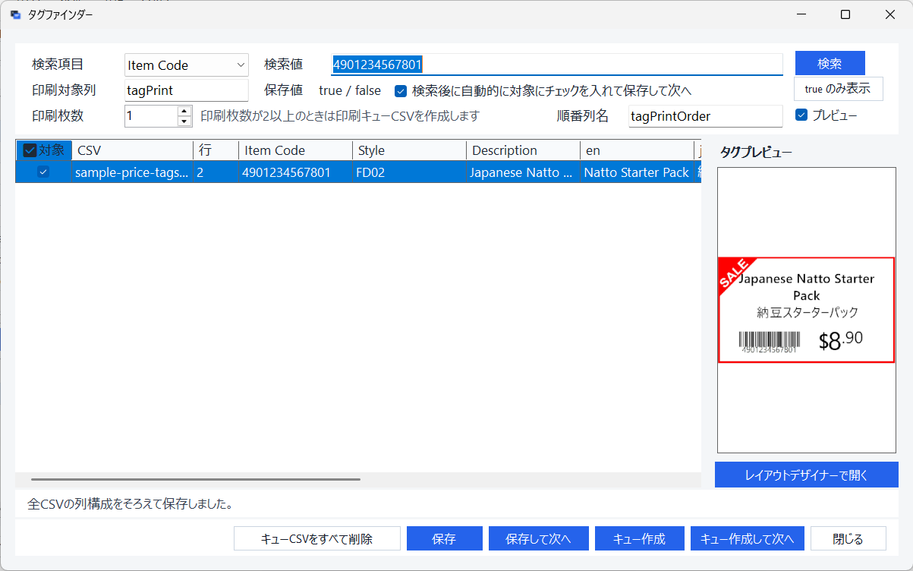
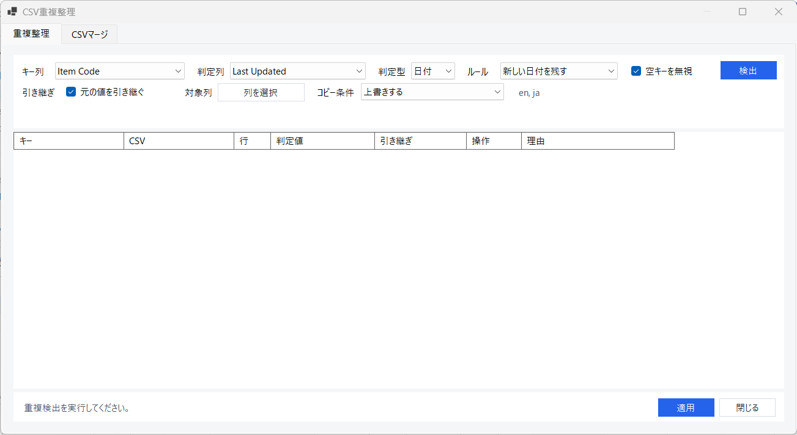
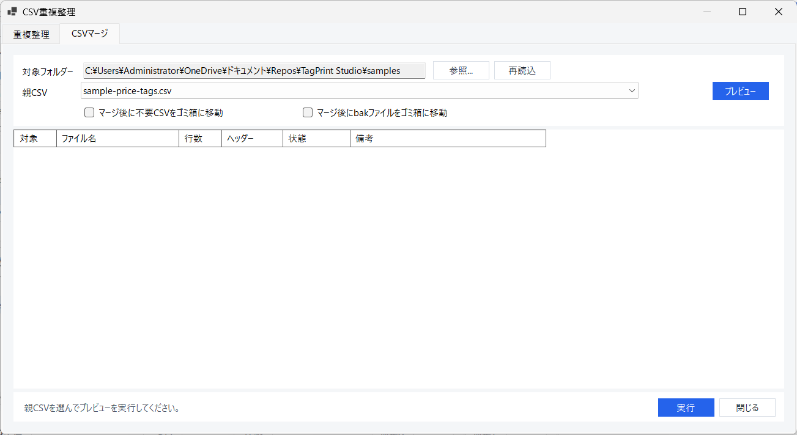

# TagPrint Studio 日本語マニュアル

対象バージョン: **TagPrint Studio v1.0.7**

TagPrint Studio は、CSV データから価格タグや商品ラベルを作成し、プレビュー、PDF/PNG 保存、直接印刷まで行える Windows デスクトップアプリです。

CSV フィールド設定、レイアウトデザイン、ページプレビュー、1 枚拡大プレビュー、PDF/PNG 出力、直接印刷、印刷順制御、印刷対象確認、CSV 重複整理、CSV マージ、タグ検索、印刷キュー CSV 作成、バーコード/QR コード、日本語/英語 UI、最近使用したファイル、起動時読み込み、設定バックアップ/インポート、バックアップファイル整理、アプリデータ保存場所の変更に対応しています。

---

## 目次

1. [概要](#1-概要)
2. [基本的な作業手順](#2-基本的な作業手順)
3. [メイン画面](#3-メイン画面)
4. [CSV フィールド設定](#4-csv-フィールド設定)
5. [CSV 読み込みとキュー CSV](#5-csv-読み込みとキュー-csv)
6. [プレビュー](#6-プレビュー)
7. [出力、PDF、PNG、印刷](#7-出力pdfpng印刷)
8. [印刷対象の確認](#8-印刷対象の確認)
9. [レイアウトデザイナー](#9-レイアウトデザイナー)
10. [バーコード / QR コード](#10-バーコード--qr-コード)
11. [タグファインダー](#11-タグファインダー)
12. [CSV 重複整理](#12-csv-重複整理)
13. [CSV マージ](#13-csv-マージ)
14. [設定](#14-設定)
15. [ファイルとデータの保存場所](#15-ファイルとデータの保存場所)
16. [トラブルシューティング](#16-トラブルシューティング)
17. [リリース前チェック](#17-リリース前チェック)

---

## 1. 概要

TagPrint Studio は、次のような用途を想定しています。

- 商品 CSV から価格タグを作成する。
- 商品名、説明、価格、画像、バーコード、QR コード付きラベルを印刷する。
- `tagPrint` などの列で印刷対象行を制御する。
- Item Code で商品を検索し、印刷対象にする。
- 複数枚印刷したい場合に、追加分の印刷キュー CSV を作成する。
- 複数 CSV にまたがる重複行を整理する。
- 複数 CSV を 1 つの親 CSV にマージする。
- PDF や PNG に保存する。
- アプリから直接印刷する。

主な画面:

| 画面 | 役割 |
|---|---|
| メイン画面 | CSV 読み込み、フィールド設定、プレビュー、出力、印刷 |
| レイアウトデザイナー | 用紙、タグ、要素、画像、バーコード、QR コード、CSV プレビュー行の編集 |
| タグファインダー | CSV 行検索、印刷対象設定、印刷キュー CSV 作成、タグプレビュー |
| CSV 重複整理 | 重複行の検出、残す行と削除する行の決定 |
| CSV マージ | フォルダー内 CSV を親 CSV に統合 |
| 印刷対象の確認 | 出力前に実際に印刷される一覧を確認 |

---

## 2. 基本的な作業手順

一般的な流れ:

1. CSV ファイル、または CSV フォルダーを読み込みます。
2. CSV フィールド設定を確認・調整します。
3. プリセットとレイアウトを選びます。
4. プレビューで出力内容を確認します。
5. 必要に応じてレイアウトデザイナーで調整します。
6. 必要に応じてタグファインダーで印刷対象を設定、または印刷キュー CSV を作成します。
7. 必要に応じて CSV 重複整理や CSV マージを行います。
8. 出力前に印刷対象を確認します。
9. PDF 保存、PNG 保存、または直接印刷を実行します。

運用上の推奨:

- 大きな CSV 整理やマージの前にはバックアップを残してください。
- 印刷前には必ずプレビューを確認してください。
- 実印刷前には印刷対象の確認を使うと安全です。
- 出力前チェックで、必須項目、バーコード、画像パス、レイアウトはみ出しを確認してください。
- プリンターごとの位置ずれは補正 X/Y で調整してください。

---

## 3. メイン画面



メイン画面は次の領域で構成されています。

- メニューバー。
- プリセット / レイアウト操作。
- CSV フィールド設定。
- CSV 読み込み一覧。
- プレビュー。
- 出力設定。

### 3.1 メニューバー

| メニュー | 主な操作 |
|---|---|
| ファイル | CSV を開く、フォルダーを開く、タグ検索、プリセット操作、出力先、終了 |
| レイアウト | レイアウトデザイナーを開く |
| 出力 | PNG 保存、PDF 保存、直接印刷 |
| 表示 | ページプレビュー、単票プレビュー、前へ/次へ |
| 設定 | 起動時 CSV/フォルダー、言語、印刷対象確認、設定バックアップ/インポート、設定ファイルの場所 |
| ヘルプ | バージョン情報 |

主なショートカット:

| ショートカット | 操作 |
|---|---|
| `Ctrl + O` | CSV を開く |
| `Ctrl + Shift + O` | CSV フォルダーを開く |
| `Ctrl + S` | プリセット保存 |
| `Ctrl + Shift + S` | プリセットに名前を付けて保存 |
| `Ctrl + L` | レイアウトデザイナーを開く |
| `Ctrl + F` | タグファインダーを開く |
| `Ctrl + E` | PDF 保存 |
| `Ctrl + Shift + P` | PNG 保存 |
| `Ctrl + P` | 直接印刷 |
| `Ctrl + 1` | ページプレビュー |
| `Ctrl + 2` | 1 枚拡大プレビュー |
| `Alt + Left` | 前のページまたはタグ |
| `Alt + Right` | 次のページまたはタグ |

### 3.2 プリセット

プリセットは、CSV フィールド定義や印刷条件を保存します。

| ボタン | 説明 |
|---|---|
| 新規 | 新しいプリセットを作成 |
| プリセット保存 | 現在の設定を保存 |
| 名前を付けて保存 | 別名で保存 |
| 複製 | 現在のプリセットを複製 |
| 名前変更 | プリセット名を変更 |
| 削除 | プリセットを削除 |

最後の 1 件は削除できないように保護されています。

### 3.3 レイアウト選択

レイアウトのドロップダウンでは、プレビュー、PDF/PNG 保存、直接印刷に使うレイアウトを選びます。編集は **レイアウトデザイナー** で行います。

---

## 4. CSV フィールド設定

**CSV フィールド** では、CSV の各列をアプリ内の項目として扱う方法を設定します。

| 列 | 説明 |
|---|---|
| 有効 | この項目を使うかどうか |
| 項目名 | UI 上に表示する名前 |
| 列番号 | CSV の列番号。`0` から開始 |
| ヘッダー名 | CSV ヘッダーの名前 |
| 必須 | 空の場合に出力前チェックで検出 |
| 条件 | 印刷条件として使用 |
| 種類 | なし、文字列、数値、日付、真偽値など |
| 演算 | 比較方法 |
| 値 | 条件に使う値 |
| 削除 | フィールドを削除 |

### 4.1 ヘッダー行

**最初の行をヘッダーとして扱う** を有効にすると、CSV の 1 行目を列名として扱い、印刷対象データから除外します。

### 4.2 自動マッピング

CSV を読み込むと、CSV ヘッダーに合わせてフィールド一覧を自動生成できます。初期データではなく、実際の CSV 構造に合わせて作業を始められます。

### 4.3 CSV列追加

CSV フィールドエリアの **CSV列追加** を使うと、読み込み済みすべての CSV の末尾に新しい列を追加できます。

動作:

- 各 CSV の末尾に新しい列を追加します。
- ヘッダー行には入力した列名を入れます。
- 既存のデータ行には空の値を追加します。
- 上書き前に `products.csv.bak-20260608-142530` のような日時付きバックアップを作成します。
- 現在のプリセットの CSV フィールド一覧にも新しい項目を追加します。

`tagPrint` のような印刷対象フラグ列や、行ごとの文字サイズを制御する列など、実 CSV に列が必要な場合に使います。

**CSV列追加** は、**最初の行をヘッダーとして扱う** が有効な場合に使用できます。

### 4.4 印刷条件

条件を使うと、印刷対象行を絞り込めます。

例:

| 項目 | 条件 |
|---|---|
| `tagPrint` | `true` と等しい |
| `Last Updated` | 指定日以降 |

### 4.5 今日の日付入力

CSV フィールド表で種類が日付の値を編集中に `Ctrl + ;` を押すと、今日の日付を入力できます。

---

## 5. CSV 読み込みとキュー CSV

**CSV 読み込み** エリアでは、CSV ファイルの読み込みと管理を行います。

| ボタン / 操作 | 説明 |
|---|---|
| CSV 選択/追加 | 1 つまたは複数の CSV を選択 |
| フォルダー選択 | フォルダー内 CSV をまとめて読み込み |
| 重複整理 | CSV 重複整理を開く |
| タグ検索 | タグファインダーを開く |
| 最近使用した CSV | 最近使った CSV を再読み込み |

CSV 一覧の列:

| 列 | 説明 |
|---|---|
| ファイル名 | CSV ファイル名 |
| パス | フルパス |
| 行数 | データ行数 |
| 列数 | 列数 |
| 状態 | 読み込み状態 |
| 備考 | 警告や補足 |
| 文字コード | 判定または保持された文字コード |

### 5.1 複数 CSV

複数 CSV を同時に読み込めます。出力単位によって、全 CSV を使うか、選択中 CSV を使うかが変わります。

### 5.2 キュー CSV

タグファインダーで印刷枚数が 2 以上の場合、追加印刷分としてキュー CSV が作成されます。

キュー CSV の仕様:

- ファイル名: `print_queue_yyyyMMdd_HHmmss.csv`
- 同じ日時名がすでに存在する場合は、`-2`、`-3` などの連番が自動で付きます。
- 保存場所: 親 CSV と同じフォルダー。
- 作成行数: `印刷枚数 - 1`。
- 親 CSV の元行が 1 枚目として扱われます。
- キュー CSV 作成後、親 CSV のフォルダーを再読み込みします。

キュー CSV の管理:

- メイン画面の CSV 一覧で、キュー CSV のみ右クリックメニューが表示されます。
- 一覧から削除、CSV を削除ができます。
- タグファインダーからキュー CSV をすべて削除できます。

---

## 6. プレビュー

プレビューでは、現在の CSV データとレイアウトの出力結果を確認できます。

| ボタン | ページ表示時 | 1 枚拡大時 |
|---|---|---|
| ページ全体 | 用紙全体を表示 | ページ表示へ切り替え |
| 1 枚拡大 | 単票表示へ切り替え | 1 つのタグを拡大表示 |
| 前へ | 前のページへ | 前の印刷対象タグへ |
| 次へ | 次のページへ | 次の印刷対象タグへ |

1 枚拡大プレビューは、プレビュー領域に合わせて高解像度で描画されます。文字、罫線、バーコード、QR コード、画像を確認しやすくなっています。

ページ全体プレビューのズーム:

- ページ全体プレビュー右下に **拡大**、**標準**、**縮小** ボタンがあります。
- 拡大時は内部的に高解像度で再描画されるため、近くで確認しやすくなります。
- 表示領域を超えた場合は縦横スクロールバーが表示されます。
- スクロールバーだけでなく、マウスの手のひらドラッグでも表示範囲を移動できます。

プレビュー下部には、出力範囲、ページ番号、印刷対象件数、用紙サイズ、タグサイズ、グリッド数が表示されます。

---

## 7. 出力、PDF、PNG、印刷

メイン画面下部で出力設定を行います。

### 7.1 出力単位

| 出力単位 | 説明 |
|---|---|
| 全体を 1 つの PDF | すべての印刷対象行を 1 つの PDF に保存 |
| CSV ごとに別 PDF | CSV ごとに PDF を作成 |
| 1 行ごとに個別 PNG | 印刷対象行ごとに PNG を作成 |

### 7.2 DPI

DPI は画像ベースの描画品質とファイルサイズに影響します。高い DPI ほど精細になりますが、ファイルサイズと処理時間が増えます。

### 7.3 印刷方式

| 方式 | 説明 |
|---|---|
| 実寸優先 | レイアウトの実寸を優先 |
| 印刷可能領域に合わせる | プリンターの印刷可能領域に合わせて拡大縮小 |

### 7.4 補正 X/Y

プリンターごとの物理的な位置ずれを mm 単位で補正します。

- `+1.5mm`: 右へ移動。
- `-0.8mm`: 上へ移動。

### 7.5 印刷順

| 印刷順 | 説明 |
|---|---|
| 読み込み順 | CSV の読み込み順、行順で出力 |
| Item Code 順 | Item Code で並び替え |
| 選択列順 | 指定した並び替え列で出力 |

### 7.6 出力先

| 操作 | 説明 |
|---|---|
| 出力先ボックス | 現在の出力先フォルダー |
| 最近使用した出力先 | 最近使った出力先を再選択 |
| 選択 | 出力先を選択 |
| 開く | 出力先フォルダーを開く |
| PNG 保存 | PNG を保存 |
| PDF 保存 | PDF を保存 |
| 直接印刷 | 直接印刷 |

出力先はアプリ終了後も保持されます。

### 7.7 PDF 保存完了

PDF 保存後の完了ダイアログでは、保存先を開くチェックボックスを使えます。この状態は前回値が保持されます。

### 7.8 進捗表示、キャンセル、partial ファイル

直接印刷、PDF 保存、PNG 保存では、処理中に進捗ダイアログが表示されます。

- ページ数などの現在の進捗を確認できます。
- **キャンセル** で中止を要求できます。直接印刷では、まだプリンターへ送っていない次ページ以降を止めます。
- PDF/PNG は `.partial` ファイルへ一時保存し、ファイル完成後に最終ファイルへ置き換えます。
- PDF/PNG 保存をキャンセルした場合、そのキャンセルされた操作で作成された出力ファイルは削除されます。
- ページ描画に失敗した場合、詳細エラーの前に進捗ダイアログ上で失敗ページを確認できます。

### 7.9 大量印刷警告

設定メニューの **大量印刷警告** で、直接印刷前に警告するページ数を変更できます。

- 指定ページ数以上の直接印刷で確認メッセージを表示します。
- しきい値を `0` にする、またはダイアログで無効にすると警告を出しません。
- メニュー名には `大量印刷警告...（100ページ）` のように現在値が表示されます。

---

## 8. 印刷対象の確認

設定で有効になっている場合、PDF 保存、PNG 保存、直接印刷の前に印刷対象の確認画面が表示されます。

確認できる内容:

- 印刷対象タグ数。
- CSV 数。
- ページ数。
- 印刷順。
- CSV ごとの概要。
- 実際の印刷順一覧。

印刷順一覧の主な列:

| 列 | 説明 |
|---|---|
| 順番 | 出力順 |
| CSV | 元 CSV |
| 行 | 元 CSV の行 |
| 並び替え値 | 並び替えに使った値 |
| 代表値 | Item Code などの代表値 |

検索:

1. 検索列を選びます。
2. 検索値を入力します。
3. **検索** を押すか、検索値欄で `Enter` を押します。
4. 見つかった行へジャンプし、ハイライト表示されます。

**続行** で出力を進め、**キャンセル** で出力を中止します。

---

## 9. レイアウトデザイナー



レイアウトデザイナーでは、タグの見た目、用紙設定、要素、CSV プレビュー行を編集します。

### 9.1 上部操作

| 操作 | 説明 |
|---|---|
| レイアウト | 編集するレイアウトを選択 |
| 新規 / 保存 / 名前を付けて保存 | レイアウトを作成・保存 |
| レイアウト複製 / 名前変更 / レイアウト削除 | レイアウト管理 |
| 要素追加 | 固定テキストを追加 |
| フィールド追加 | CSV 列に紐づくテキストを追加 |
| 画像追加 | 画像要素を追加 |
| バーコード追加 | バーコードまたは QR コードを追加 |
| 複製 / 要素削除 | 選択要素を複製・削除 |
| 元に戻す / やり直し | 操作履歴 |
| 整列 | 選択要素を整列 |
| グリッド / スナップ / グリッド mm | キャンバス補助 |

### 9.2 キャンバス表示サイズ

キャンバス右下には縦並びのボタンがあります。

| ボタン | 説明 |
|---|---|
| 拡大 | 上部セパレーターを 10% ずつ上へ移動。最大 +50% |
| 標準 | 初期位置へ戻す |
| 縮小 | 上部セパレーターを 10% ずつ下へ移動。最小 -40% |

これは表示領域の調整であり、タグの実寸は変わりません。

### 9.3 要素一覧

| 列 | 説明 |
|---|---|
| 名前 | 要素名 |
| 種類 | StaticText、FieldText、Image、PriceValue、Barcode など |
| Z | 重なり順 |
| 固定 | 誤操作防止 |
| 表示 | 表示 / 非表示 |

### 9.4 プロパティ

用紙設定:

- 用紙サイズ、単位。
- 用紙幅/高さ。
- タグ幅/高さ。
- 余白。
- 横間隔 / 縦間隔。
- 自動グリッド。
- 行数 / 列数。

要素設定:

- 名前。
- X/Y 位置。
- 幅/高さ。
- Z。
- フィールド。
- フォント、文字サイズ、太字。
- サイズ指定: 固定値または CSV 列。
- サイズ列: 行ごとの文字サイズとして使う CSV フィールド。
- 最小/最大文字サイズ。
- 揃え。
- 文字色、背景色、枠線色、枠線幅。
- 小数表示、小数桁。
- バーコード種類、下の文字表示。
- 画像パス、縦横比。
- 固定、表示。

#### 行ごとの文字サイズ

テキスト系の要素では、文字サイズを固定値にするか、CSV フィールドから取得するかを選べます。

**サイズ指定** を **CSV列** にすると、選択した **サイズ列** の値を現在の CSV 行から読み取り、その行の文字サイズとして使います。列が存在しない、値が空、数値として読めない場合は、固定の文字サイズに戻ります。読み取った値は、要素の最小/最大文字サイズの範囲内に収められます。

### 9.5 キャンバス編集

キャンバス上では次の操作ができます。

- 要素をクリックして選択。
- ドラッグで移動。
- ハンドルでリサイズ。
- グリッドとスナップで位置合わせ。
- テキスト要素をダブルクリックして直接編集。

テキスト直接編集:

| キー | 動作 |
|---|---|
| `Enter` | 確定 |
| `Shift + Enter` | 改行 |
| `Esc` | キャンセル |

直接編集時の入力欄は、キャンバス上の表示サイズに近いフォントサイズになります。日本語 IME 入力にも対応しています。

### 9.6 プレビュー行と CSV 編集

CSV を読み込んだ状態で開くと、メイン画面の出力単位、フィルター、選択 CSV 状態に合わせた CSV 行がレイアウトデザイナーに渡されます。

| 操作 | 説明 |
|---|---|
| プレビュー行 | 表示する CSV 行を選択 |
| ページ表示 | 用紙全体を表示 |
| 単票表示 | 1 タグを表示 |
| 前へ / 次へ | プレビュー行を移動 |
| 列 | 編集する CSV 列を選択 |
| 値 | 現在セルの値を表示・編集 |
| CSV 保存 | 編集済み CSV 値を保存 |

---

## 10. バーコード / QR コード

対応種類:

| 種類 | 用途 |
|---|---|
| Code128 | 商品 ID、管理コード、英数字 |
| EAN-13 / JAN-13 | 商品バーコード |
| QR Code | URL、商品 ID、管理コード、任意テキスト |

出力前チェックでは次の問題を検出できます。

- 必須項目が空。
- バーコード値が空。
- EAN-13/JAN-13 が不正。
- 未対応バーコード種類。
- Code128 未対応文字。
- 画像ファイルが存在しない。
- 要素が印刷範囲やタグ範囲からはみ出している。
- バーコード要素が推奨サイズ未満。

警告は確認後に続行できます。重大な問題は出力を停止します。

---

## 11. タグファインダー



タグファインダーは、読み込み済み CSV 全体から行を検索し、選択した保存列へ値を書き込みます。

基本手順:

1. 検索項目に `Item Code` などを選びます。
2. 検索値を入力します。
3. 保存列に `tagPrint` などを指定します。
4. 保存値に `true` などを指定します。
5. 検索します。
6. 一致行を確認し、対象チェックを付けます。
7. 保存、保存して次へ、キュー作成、キュー作成して次へを押します。
8. `trueのみ` を使うと、すでに印刷対象にした行だけを確認できます。
9. `trueのみ` 一覧で行をダブルクリックすると、その行の検索項目の値を検索値へ戻せます。

主な操作:

| 操作 | 説明 |
|---|---|
| 検索項目 | 検索に使う CSV 項目 |
| 検索値 | 検索する値 |
| 保存列 | 値を書き込む列 |
| 保存値 | `true` / `false` など |
| 順番列 | `tagPrintOrder` など、印刷対象にした順序を保持する列 |
| 印刷枚数 | 印刷したい枚数 |
| プレビュー | 小型プレビューの表示切替 |
| true のみ表示 | 保存列が `true` の行だけ表示 |
| 検索後に自動的に対象へチェック | 検索結果を自動チェック |
| キュー CSV をすべて削除 | キュー CSV を削除 |
| レイアウトデザイナーで開く | 現在のプレビュー行をレイアウトデザイナーで開く |
| 保存 | チェック行へ保存。印刷枚数 2 以上ならキュー CSV も作成 |
| 保存して次へ | 保存して次の検索へ |
| キュー作成 | チェック行からキュー CSV を作成。`true のみ表示` 中は現在対象の行を使用 |
| キュー作成して次へ | キュー作成後、次の検索へ |

保存列が存在しない場合、列数不一致を避けるため、読み込み済みすべての CSV に同じ列が追加されます。

キュー CSV の挙動:

- ファイル名: `print_queue_yyyyMMdd_HHmmss.csv`
- 同じ日時名がすでに存在する場合は、`-2`、`-3` などの連番が自動で付きます。
- 保存場所: 親 CSV と同じフォルダー。
- 行数: `印刷枚数 - 1`。
- 親 CSV の元行が 1 枚目として残ります。
- 保存系操作、キュー作成系操作のあと、印刷枚数は `1` に戻ります。
- `trueのみ` 表示中のキュー作成は、一覧全体ではなく現在対象の行に対して行われます。

小型プレビュー:

- 表示 / 非表示を切り替えできます。
- 前回の表示状態を保持します。
- 現在のプレビュー行をそのままレイアウトデザイナーで開けます。
- プレビュー見出しはタグプレビュー名のみを表示し、ファイル名や行番号の付加表示は行いません。

キュー CSV の整理:

- タグファインダーからキュー CSV を削除できます。
- メイン画面 CSV 一覧からも削除できます。
- タグファインダーを閉じるとき、印刷対象が残っていないキュー CSV が見つかれば整理確認が表示されます。

---

## 12. CSV 重複整理



CSV 重複整理では、複数 CSV にまたがる重複行を検出し、どの行を残すかを決めます。

### 12.1 重複検出

| 操作 | 説明 |
|---|---|
| キー列 | 重複判定に使う列 |
| 判定列 | 残す行を決める列 |
| 判定型 | 日付、数値、文字列 |
| ルール | 新しい日付、古い日付、最大値、最小値、先勝ちなど |
| 空キーを無視 | キーが空の行を検出から除外 |

結果列:

| 列 | 説明 |
|---|---|
| キー | 重複キー |
| CSV | 元 CSV |
| 行 | 行番号 |
| 判定値 | 判定列の値 |
| 引き継ぎ | コピー予定の列 |
| 操作 | 残す / 削除 |
| 理由 | 判定理由 |

列ヘッダーをクリックすると並び替えできます。

### 12.2 値の引き継ぎ

削除対象行から残す行へ、指定列の値をコピーできます。

| コピー条件 | 説明 |
|---|---|
| 残す側が空ならコピー | 空セルのみ補完 |
| 上書きする | 既存値も置き換え |

対象列、チェック状態、コピー条件は前回値が保持されます。

### 12.3 適用

**適用** を押すと、検出結果に基づいて CSV が更新されます。

- CSV のバックアップを作成します。
- 削除対象行を削除します。
- 有効な場合は値を引き継ぎます。
- 適用後もウィンドウは閉じません。

---

## 13. CSV マージ



CSV マージでは、同一フォルダー内の複数 CSV を、選択した親 CSV に追記できます。

手順:

1. 対象フォルダーを選択します。
2. 親 CSV を選択します。
3. プレビューを実行します。
4. 対象ファイルを確認します。
5. 実行します。

オプション:

| オプション | 説明 |
|---|---|
| マージ後に不要 CSV をゴミ箱に移動 | マージ済み子 CSV をゴミ箱へ移動 |
| マージ後に bak ファイルをゴミ箱に移動 | 作成されたバックアップをゴミ箱へ移動 |

対象フォルダー、親 CSV、チェック状態は前回値が保持されます。

安全性:

- 親 CSV は上書き前にバックアップされます。
- ヘッダー不一致の CSV はスキップされます。
- 確認メッセージには、ゴミ箱へ移動されるファイル名が表示されます。

---

## 14. 設定

設定メニューではアプリの動作を管理します。

| 項目 | 説明 |
|---|---|
| 起動時 CSV | 起動時に読み込む CSV |
| 起動時 CSV の場所を開く | 指定済み CSV の場所を開く |
| 起動時 CSV を解除 | 起動時 CSV を解除 |
| 起動時フォルダー | 起動時に読み込むフォルダー |
| 起動時フォルダーを開く | 指定済みフォルダーを開く |
| 起動時フォルダーを解除 | 起動時フォルダーを解除 |
| バックアップファイル整理 | 日時付き CSV バックアップを確認・整理 |
| アプリデータ保存場所を変更する | レイアウト、プリセット、最近使用したファイル、設定の保存先ルートを変更 |
| アプリデータ保存場所を開く | 現在のアプリデータ保存場所を開く |
| アプリデータ保存場所を既定に戻す | 再起動後に既定の保存場所へ戻す |
| 出力前に印刷対象を確認 | 印刷対象確認のオン/オフ |
| 設定をインポート | 設定 ZIP を読み込む |
| 設定をバックアップ | 設定 ZIP を作成 |
| 設定ファイルの場所を開く | 設定保存場所を開く |
| 言語 | 日本語 / 英語の切り替え |

### 14.1 設定バックアップ

バックアップでは次のフォルダーを ZIP にまとめ、現在の出力先に保存します。

```text
layouts/
presets/
recent/
settings/
```

### 14.2 設定インポート

バックアップ ZIP から、レイアウト、プリセット、最近使用したファイル、アプリ設定を復元します。

### 14.3 バックアップファイル整理

バックアップファイル整理では、`products.csv.bak-20260608-142530` のような日時付き CSV バックアップを管理します。

- 対象フォルダーを選択します。
- 保持日数を指定します。
- CSV ごとの最大保持件数を指定します。
- 整理前に対象バックアップ一覧を確認できます。
- 整理対象はゴミ箱へ移動します。

起動時フォルダーを設定・変更したときは、確認後にバックアップファイル整理の対象フォルダーも同じ場所へ合わせられます。

---

### 14.4 アプリデータ保存場所

アプリデータ保存先ルートは設定メニューから変更できます。この場所には、アプリが管理する次のフォルダーが保存されます。

```text
layouts/
presets/
recent/
settings/
cache/
temp/
logs/
```

保存場所を変更するときは、現在の `layouts`、`presets`、`recent`、`settings` を新しい場所へコピーするか選択できます。変更を反映するにはアプリの再起動が必要です。

---

## 15. ファイルとデータの保存場所

アプリ設定は、設定でカスタム保存場所を指定していない場合、ユーザーのアプリケーションデータ領域に保存されます。

主なフォルダー:

| フォルダー | 内容 |
|---|---|
| `layouts` | レイアウト定義 |
| `presets` | プリセット定義 |
| `recent` | 最近使用した CSV / 出力先 |
| `settings` | アプリ設定 |
| `cache` | キャッシュ |
| `temp` | 一時ファイル |
| `logs` | ログ |

アプリデータ保存場所は設定メニューから変更、表示、既定へのリセットができます。変更時には現在の `layouts`、`presets`、`recent`、`settings` を新しい場所へコピーでき、反映にはアプリの再起動が必要です。

標準の出力先:

```text
Documents\TagPrint Studio Exports
```

---

## 16. トラブルシューティング

### CSV の文字が化ける

CSV を UTF-8 BOM または Shift_JIS で保存し直してください。複数 CSV で文字コードが混在していないかも確認してください。

### 印刷対象が表示されない

印刷条件の項目、種類、演算、値、必須項目、列番号、読み込み済み CSV の状態を確認してください。

### PDF が想定外の場所に保存される

メイン画面下部の出力先ボックスと、最近使用した出力先を確認してください。出力先は前回値が保持されます。

### 直接印刷で位置がずれる

印刷方式、実寸優先 / 印刷可能領域に合わせる、補正 X/Y、用紙サイズ、プリンターのハードマージンを確認してください。

### バーコードや QR コードが警告になる

値の空欄、EAN/JAN の桁数、Code128 未対応文字、要素サイズ、画像パス、フィールド設定を確認してください。

### CSV の列数が一致しない

一部 CSV の列数が違う可能性があります。タグファインダーで保存列を追加する場合は、読み込み済みすべての CSV に同じ列が追加されます。保存後にフォルダーを再読み込みし、ヘッダーが揃っているか確認してください。

### 削除したキュー CSV がタグファインダーに表示される

親 CSV のフォルダーを再読み込みしてください。再読み込み後は、存在しないキュー CSV は検索対象から外れます。

---

## 17. リリース前チェック

リリース前の推奨確認:

1. アプリを起動する。
2. 日本語 UI と英語 UI を切り替える。
3. CSV ファイル選択とフォルダー選択を確認する。
4. CSV フィールドの自動生成を確認する。
5. ページ全体プレビューを確認する。
6. 1 枚拡大プレビューと前へ/次へのタグ移動を確認する。
7. PDF 保存を確認する。
8. PNG 保存を確認する。
9. 直接印刷または印刷プレビューを確認する。
10. 印刷対象確認と検索を確認する。
11. レイアウトデザイナーを開く。
12. 要素の移動、リサイズ、固定、非表示、整列を確認する。
13. 拡大、標準、縮小ボタンを確認する。
14. キャンバス上で `Enter`、`Shift + Enter`、`Esc` によるテキスト編集を確認する。
15. レイアウト保存と再読み込みを確認する。
16. Code128、EAN-13/JAN-13、QR Code を確認する。
17. タグファインダーで `true` 保存を確認する。
18. 印刷枚数 2 以上でキュー CSV 作成を確認する。
19. キュー CSV 削除を確認する。
20. CSV 重複整理の検出と適用をテストデータで確認する。
21. CSV マージをテストデータで確認する。
22. 設定バックアップを確認する。
23. 設定インポートを確認する。
24. 設定ファイルの場所を開く操作を確認する。
