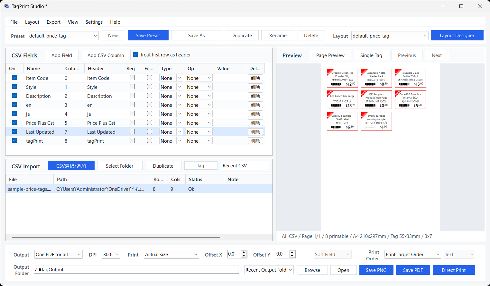
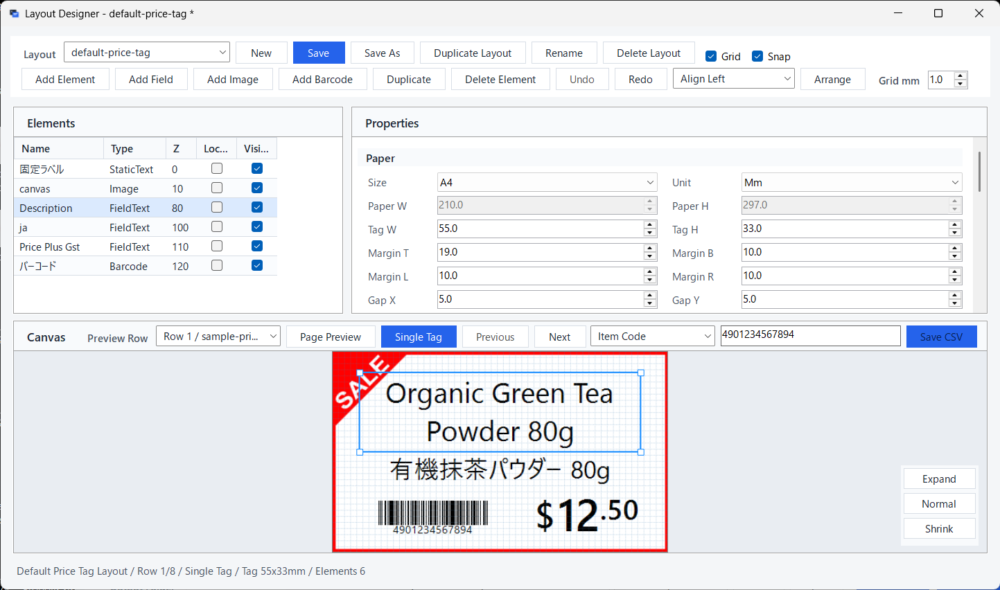
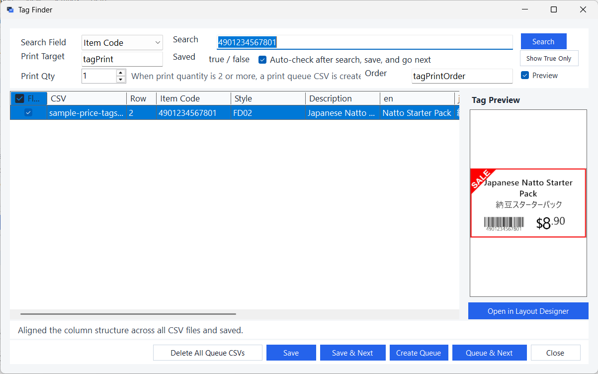
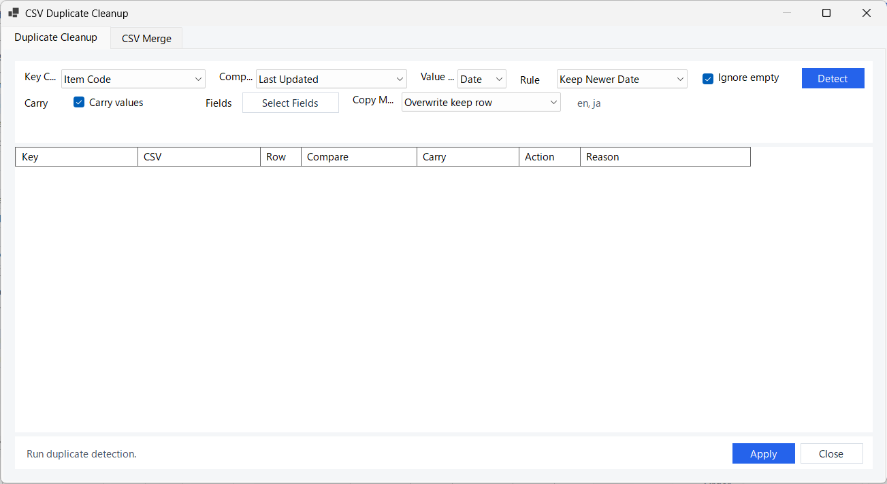
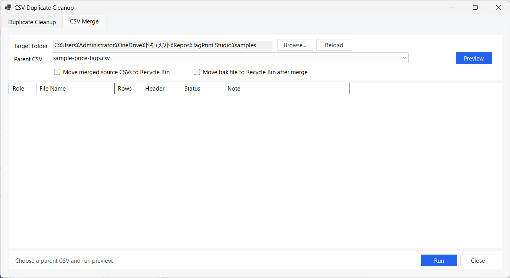

# TagPrint Studio User Manual

Target version: **TagPrint Studio v1.0.8**

TagPrint Studio is a Windows desktop application for designing, previewing, exporting, and printing price tags and product labels from CSV data.

It supports CSV field mapping, layout design, page and single-tag preview, PDF/PNG output, direct printing, print order control, print target confirmation, duplicate cleanup, CSV merging, tag searching, print queue CSV creation, barcode/QR code elements, Japanese/English UI localization, recent files, startup loading, settings backup/import, backup cleanup, crash logging, and custom app data storage locations.

---

## Table of Contents

1. [Overview](#1-overview)
2. [Main Workflow](#2-main-workflow)
3. [Main Window](#3-main-window)
4. [CSV Field Settings](#4-csv-field-settings)
5. [CSV Import and Queue CSV Files](#5-csv-import-and-queue-csv-files)
6. [Preview](#6-preview)
7. [Output, PDF, PNG, and Printing](#7-output-pdf-png-and-printing)
8. [Print Target Confirmation](#8-print-target-confirmation)
9. [Layout Designer](#9-layout-designer)
10. [Barcode and QR Code Elements](#10-barcode-and-qr-code-elements)
11. [Tag Finder](#11-tag-finder)
12. [CSV Duplicate Cleanup](#12-csv-duplicate-cleanup)
13. [CSV Merge](#13-csv-merge)
14. [Settings](#14-settings)
15. [Files, Data Locations, and Safety Files](#15-files-data-locations-and-safety-files)
16. [Troubleshooting](#16-troubleshooting)
17. [Release Check List](#17-release-check-list)

---

## 1. Overview

TagPrint Studio is intended for workflows such as:

- Creating price tags from product CSV files.
- Printing labels with item names, descriptions, prices, images, barcodes, and QR codes.
- Selecting printable rows with a flag column such as `tagPrint`.
- Searching Item Codes and marking matching rows for output.
- Creating extra print queue rows when more than one copy is needed.
- Preserving source CSV structure, including blank physical rows.
- Cleaning duplicate rows across multiple CSV files.
- Merging multiple CSV files into one parent CSV.
- Exporting labels to PDF or PNG.
- Printing directly from the application.
- Backing up and importing application settings.
- Reviewing crash logs after unexpected errors.

Main screens:

| Screen | Purpose |
|---|---|
| Main window | CSV import, field mapping, preview, output, export, and print |
| Layout Designer | Edit paper, tag layout, elements, images, barcodes, QR codes, and CSV preview rows |
| Tag Finder | Search CSV rows, mark target rows, create print queue CSV files, and preview tags |
| CSV Duplicate Cleanup | Detect duplicate rows and decide which row to keep |
| CSV Merge | Merge CSV files from a folder into a parent CSV |
| Backup File Cleanup | Preview and remove old timestamped CSV backup files |
| Print Target Confirmation | Review the exact output target list before export or direct print |

---

## 2. Main Workflow

Typical workflow:

1. Import one or more CSV files.
2. Confirm or adjust CSV field settings.
3. Select a preset and layout.
4. Preview the output.
5. Open the Layout Designer if the tag design needs adjustment.
6. Use Tag Finder to mark printable rows or create print queue CSV files if needed.
7. Use CSV Duplicate Cleanup or CSV Merge if needed.
8. Confirm print targets before output.
9. Save PDF, save PNG, or print directly.

Recommended operational workflow:

1. Keep an original CSV backup before large cleanup or merge work.
2. Use preview before printing.
3. Use print target confirmation before actual output.
4. Use preflight checks to catch missing values, invalid barcodes, missing images, and layout problems.
5. Use print X/Y offsets for printer-specific position correction.
6. When replacing existing PDF/PNG files, let the app finish normally so temporary backups can be cleaned up.
7. If an unexpected error occurs, check the app data `logs` folder.

---

## 3. Main Window



The main window contains:

- Menu bar.
- Preset and layout controls.
- CSV field settings.
- CSV import list.
- Preview area.
- Output controls.

### 3.1 Menu Bar

| Menu | Main actions |
|---|---|
| File | New/save preset, open CSV, open folder, Tag Finder, output folder, exit |
| Layout | Open Layout Designer |
| Export | Save PNG, save PDF, direct print |
| View | Page preview, single-tag preview, previous/next navigation |
| Settings | Startup CSV/folder, backup cleanup, language, print target confirmation, settings backup/import, settings location, app data location |
| Help | Version information |

Common shortcuts:

| Shortcut | Action |
|---|---|
| `Ctrl + N` | New preset |
| `Ctrl + O` | Open CSV |
| `Ctrl + Shift + O` | Open CSV folder |
| `Ctrl + S` | Save preset |
| `Ctrl + Shift + S` | Save preset as |
| `Ctrl + L` | Open Layout Designer |
| `Ctrl + F` | Open Tag Finder |
| `Ctrl + E` | Save PDF |
| `Ctrl + Shift + P` | Save PNG |
| `Ctrl + P` | Direct print |
| `Ctrl + 1` | Page preview |
| `Ctrl + 2` | Single-tag preview |
| `Alt + Left` | Previous page or tag |
| `Alt + Right` | Next page or tag |
| `Ctrl + Alt + O` | Configure startup CSV |
| `Ctrl + Alt + F` | Configure startup folder |

### 3.2 Presets

A preset stores CSV field definitions and print-condition settings. It does not store the tag layout itself.

| Button or menu item | Description |
|---|---|
| New | Create a new preset |
| Save Preset | Save current field settings |
| Save As | Save the preset under a new name |
| Duplicate | Duplicate the current preset |
| Rename | Rename the current preset |
| Delete | Delete the current preset |

Deletion is protected so that the last preset cannot be removed accidentally.

### 3.3 Layout Selection

The Layout dropdown selects the layout used for preview, PDF/PNG export, and direct printing. Use **Layout Designer** to create or edit layouts.

Layouts and presets are separate:

| Item | Stores |
|---|---|
| Preset | CSV fields, column mapping, required settings, print conditions |
| Layout | Paper, tag grid, element positions, fonts, images, barcodes, QR codes |

---

## 4. CSV Field Settings

The **CSV Fields** table defines how CSV columns are interpreted.

| Column | Description |
|---|---|
| Enabled | Whether the field is used |
| Name | Display name used in the UI |
| Column | CSV column index, starting from `0` |
| Header | CSV header name |
| Required | Marks the field as required |
| Filter / condition | Enables print-condition filtering |
| Type | Condition type such as none, string, number, date, or boolean |
| Op | Comparison operator |
| Value | Comparison value |
| Delete | Removes the field from the preset |

### 4.1 Header Row

When **Treat first row as header** is enabled, the first CSV row is used as column names and is not printed as data.

Header row mode is recommended because it allows:

- Automatic field mapping.
- More readable field names.
- Safer CSV column addition.
- Easier Tag Finder and duplicate cleanup setup.

### 4.2 Automatic Field Mapping

When a CSV is loaded, the app can replace the default field list with fields based on the CSV header. This keeps the field list aligned with the actual CSV structure.

### 4.3 Add CSV Column

Use **Add CSV Column** in the CSV Fields area to append a new column to every loaded CSV file.

Behavior:

- The new column is added to the end of each loaded CSV.
- The first row header receives the entered column name.
- Existing data rows receive an empty value in the new column.
- Blank physical rows remain blank physical rows.
- Each CSV is backed up with a timestamped name such as `products.csv.bak-20260608-142530` before it is overwritten.
- The new field is also added to the current preset field list.

This is useful when a layout or workflow needs a real CSV column, for example:

| Column | Use |
|---|---|
| `tagPrint` | Print target flag |
| `tagPrintOrder` | Output marking order |
| `en.font.size` | English text font size |
| `ja.font.size` | Japanese text font size |

**Add CSV Column** requires **Treat first row as header** to be enabled.

### 4.4 Print Conditions

Print conditions decide which rows are printable.

Common examples:

| Field | Condition |
|---|---|
| `tagPrint` | Equals `true` |
| `Last Updated` | On or after a specified date |
| `Stock` | Greater than `0` |

Blank physical rows are not printable even if field settings would otherwise match.

### 4.5 Date Value Shortcut

When editing a date condition value in the CSV field table, use `Ctrl + ;` to insert today's date.

---

## 5. CSV Import and Queue CSV Files

The **CSV Import** area loads and manages source CSV files.

| Button or control | Description |
|---|---|
| Select CSV/Add | Select one or more CSV files |
| Select Folder | Load CSV files from a folder |
| Duplicate Cleanup | Open CSV Duplicate Cleanup |
| Tag Finder | Open Tag Finder |
| Recent CSV | Reopen a recently used CSV |

### 5.1 CSV File List

| Column | Description |
|---|---|
| File | CSV file name |
| Path | Full path |
| Rows | Row count |
| Cols | Column count |
| Status | Import status |
| Note | Warnings or details |
| Encoding | Detected or preserved encoding |

### 5.2 Encoding Detection

The app detects common CSV encodings in this order:

1. UTF-8 BOM.
2. UTF-16 LE BOM.
3. UTF-16 BE BOM.
4. Valid UTF-8 without BOM.
5. Shift_JIS fallback.

The detected or preserved encoding is shown in the CSV file list.

### 5.3 Delimiter Detection

The app can detect these delimiters:

- Comma.
- Tab.
- Semicolon.

Detection uses up to the first 20 records, not only the first record. Candidate delimiters are scored by:

- How many records contain the delimiter.
- Whether the parsed column count is consistent across records.
- Total delimiter count.
- Candidate priority.

Delimiters inside quoted values are ignored for detection.

Example where semicolon is detected from later records:

```csv
Title
A;B;C
1;2;3
```

### 5.4 Blank Rows

Blank physical CSV rows are preserved.

Behavior:

- They remain in memory as blank rows.
- They are written back as blank rows when CSV is saved.
- They are skipped for printing.
- They are skipped for column-count mismatch validation.
- They are not treated as data rows for print target generation.

### 5.5 Multiple CSV Files

Multiple CSV files can be loaded at the same time. Output scope controls whether all CSV files or only the selected CSV are used.

When multiple CSVs are loaded, keep headers and column counts consistent unless the specific feature allows skipping mismatched files.

### 5.6 Queue CSV Files

Tag Finder can create queue CSV files when print quantity is 2 or more.

Queue file behavior:

- File name: `print_queue_yyyyMMdd_HHmmss.csv`.
- If the same timestamp already exists, suffixes such as `-2`, `-3`, and so on are added automatically.
- Location: same folder as the parent CSV.
- Row count: `print quantity - 1`.
- The parent CSV row remains the normal first copy.
- After creating a queue CSV, the parent CSV folder is reloaded.

Queue CSV management:

- In the main CSV list, queue CSV files have a right-click menu.
- The menu can remove the queue CSV from the list or delete the CSV file.
- Tag Finder also has a button to delete all queue CSV files.
- Queue CSV files are ignored by CSV Merge and duplicate cleanup workflows where appropriate.

---

## 6. Preview

The Preview area shows how the current CSV data and layout will be output.

| Button | Page Preview behavior | Single Tag behavior |
|---|---|---|
| Page Preview | Shows the whole paper page | Switches to page view |
| Single Tag | Switches to single-tag view | Shows one tag enlarged |
| Previous | Previous page | Previous printable tag |
| Next | Next page | Next printable tag |

Single-tag preview is rendered at a higher resolution based on the preview area size. This makes text, borders, barcodes, QR codes, and images easier to inspect.

Page preview zoom:

- The bottom-right of the page preview includes **Expand**, **Normal**, and **Shrink** controls.
- Zoomed page preview rerenders at a higher internal resolution for clearer close inspection.
- When the zoomed page exceeds the viewport, vertical and horizontal scroll bars appear.
- The zoomed page can also be moved by hand-pan dragging with the mouse.

Preview status text shows:

- Output scope.
- Current page.
- Printable row count.
- Paper size.
- Tag size.
- Grid count.

---

## 7. Output, PDF, PNG, and Printing

The output controls are located at the bottom of the main window.

### 7.1 Output Unit

| Output unit | Description |
|---|---|
| All CSVs together | For PDF, save all printable rows into one PDF. For PNG, output page PNG files per CSV. |
| Separate output per CSV | For PDF, save one PDF per CSV. For PNG, output page PNG files per CSV. |
| Individual PNG per row | Save each printable row as PNG. |

### 7.2 DPI

DPI affects image-based rendering quality and file size. Higher DPI improves output quality but increases file size and processing time.

### 7.3 Print Scaling

| Mode | Description |
|---|---|
| Actual size | Preserves the real layout dimensions |
| Fit to printable area | Scales output to fit the printer's printable area |

### 7.4 Print Offsets

Use **Offset X** and **Offset Y** to correct printer-specific physical shifts.

Examples:

- `+1.5mm` moves output to the right.
- `-0.8mm` moves output upward.

### 7.5 Print Order

| Mode | Description |
|---|---|
| Load Order | Use the loaded CSV and row order |
| Item Code | Sort by Item Code |
| Selected Field | Sort by the selected sort field |

### 7.6 Output Folder

| Control | Description |
|---|---|
| Output folder textbox | Current output folder |
| Recent output folder | Reopen recently used output folders |
| Browse | Select output folder |
| Open | Open output folder |
| Save PNG | Save PNG output |
| Save PDF | Save PDF output |
| Direct Print | Print directly |

The output folder is saved and restored between app launches.

### 7.7 PDF Save Completion

After PDF save, a completion dialog can optionally open the output folder. The checkbox state is remembered.

### 7.8 Progress, Cancellation, Partial Files, and Restore

Direct print, PDF export, and PNG export show a progress dialog during long-running output.

- The dialog shows current progress such as page count.
- **Cancel** requests cancellation.
- For direct print, cancellation stops the next pages that have not yet been sent to the printer.
- PDF/PNG output writes to a unique `.partial-*` file first.
- A completed partial file is moved into place only after that output file has rendered successfully.
- If the target file already exists, the existing file is temporarily backed up before replacement.
- If the operation is canceled or fails, newly created files are removed and overwritten existing files are restored from their temporary backups.
- If the operation completes successfully, temporary backups are removed.
- If rendering fails on a page, the progress dialog shows the failed page number before the detailed error is shown.

This behavior is especially important for:

- PNG export that produces multiple files.
- PDF export per CSV.
- Re-exporting into a folder that already contains older files with the same names.

### 7.9 Large Print Warning

The Settings menu includes **Large Print Warning**.

- Set the page count where a warning should appear before direct printing.
- Set the threshold to `0` or turn it off in the dialog to disable the warning.
- The menu label shows the current threshold, such as `Large Print Warning... (100 pages)`.

---

## 8. Print Target Confirmation

Print target confirmation appears before output when enabled from Settings.

It shows:

- Total tag count.
- CSV count.
- Page count.
- Active print order.
- CSV summary list.
- Ordered print target list.

The ordered list includes:

| Column | Description |
|---|---|
| Order | Output order |
| CSV | Source CSV |
| Row | Source row |
| Sort Value | Value used for selected sorting |
| Key Value | Representative value such as Item Code |

Search:

1. Select the search column.
2. Enter a search value.
3. Press **Search** or press `Enter` in the search value field.
4. The matching row is selected and highlighted.

Use **Continue** to proceed or **Cancel** to stop output.

---

## 9. Layout Designer



The Layout Designer edits tag layouts.

### 9.1 Top Controls

| Control | Description |
|---|---|
| Layout | Select layout |
| New | Create layout |
| Save | Save layout |
| Save As | Save as new layout |
| Duplicate Layout | Duplicate layout |
| Rename | Rename layout |
| Delete Layout | Delete layout |
| Add Element | Add generic text element |
| Add Field | Add CSV-linked text |
| Add Image | Add image element |
| Add Barcode | Add barcode or QR code |
| Duplicate | Duplicate selected element |
| Delete Element | Delete selected element |
| Undo / Redo | Edit history |
| Arrange | Align selected elements |
| Grid | Show grid |
| Snap | Snap to grid |
| Grid mm | Grid interval |

### 9.2 Canvas Area Controls

The bottom-right of the canvas contains vertical controls:

| Button | Description |
|---|---|
| Expand | Moves the upper splitter upward by 10%, maximum +50% |
| Normal | Restores the default splitter position |
| Shrink | Moves the upper splitter downward by 10%, minimum -40% |

This changes the visible canvas area, not the real tag size.

### 9.3 Elements List

| Column | Description |
|---|---|
| Name | Element name |
| Type | StaticText, FieldText, Image, PriceValue, Barcode, etc. |
| Z | Stacking order |
| Locked | Prevents accidental movement/editing |
| Visible | Shows or hides the element |

### 9.4 Properties Panel

Paper/layout settings include:

- Paper size and unit.
- Paper width/height.
- Tag width/height.
- Margins.
- Horizontal and vertical gaps.
- Auto grid.
- Rows and columns.

Element settings include:

- Name.
- X/Y position.
- Width/height.
- Z-index.
- Field.
- Font family and size.
- Size source: fixed font size or CSV field.
- Size field: CSV field used as the row-specific font size.
- Minimum and maximum font size limits.
- Bold.
- Alignment.
- Text, background, border color, and border width.
- Decimal style and decimal places.
- Barcode type and text visibility.
- Image path and aspect ratio.
- Locked and visible flags.

#### Row-specific font size

Text-based elements can use either a fixed font size or a CSV field as the font-size source.

When **Size Source** is set to **CSV Field**, the selected **Size Field** is read from the current CSV row. If the column is missing, empty, or not a valid number, the element falls back to its fixed font size. Valid CSV values are clamped between the element's minimum and maximum font size.

### 9.5 Canvas Editing

You can:

- Select elements on the canvas.
- Move and resize elements.
- Use grid and snap.
- Double-click text to edit directly.
- Use `Enter` to apply text edits.
- Use `Shift + Enter` to insert a line break.
- Use `Esc` to cancel text edits.

Japanese IME input is supported during direct text editing.

### 9.6 Preview Row and CSV Editing

When opened from the main window with CSV data loaded, the Layout Designer receives preview rows based on the current output scope, print filters, and selected CSV state.

Controls above the canvas:

| Control | Description |
|---|---|
| Preview Row | Select CSV row to preview |
| Page Preview | Show page preview |
| Single Tag | Show single-tag preview |
| Previous / Next | Move between preview rows |
| Column | Select CSV column |
| Value | Edit current cell value |
| Save CSV | Save edited values to CSV |

CSV save from the Layout Designer uses the same CSV preservation rules as the main app, including blank-row preservation and timestamped CSV backup creation where applicable.

---

## 10. Barcode and QR Code Elements

Supported types:

| Type | Use |
|---|---|
| Code128 | Product IDs, internal codes, mixed text |
| EAN-13 / JAN-13 | Retail product barcode |
| QR Code | URLs, product IDs, internal codes, general text |

EAN-13 / JAN-13 behavior:

| Input | Behavior |
|---|---|
| 12 digits | The check digit is calculated automatically |
| 13 digits | The check digit is validated |
| Other values | Reported as invalid by preview/preflight |

Preflight checks can report:

- Empty required fields.
- Empty barcode values.
- Invalid EAN-13/JAN-13 values.
- Unsupported barcode types.
- Unsupported Code128 characters.
- Missing image files.
- Elements outside printable/tag area.
- Undersized barcode elements.

Warnings can be acknowledged; blocking errors stop output.

---

## 11. Tag Finder



Tag Finder searches all loaded CSV files and writes a value to a selected save column.

Typical workflow:

1. Select search field, such as `Item Code`.
2. Enter the search value.
3. Enter or select a save column, such as `tagPrint`.
4. Choose the save value, such as `true`.
5. Search.
6. Check matching rows.
7. Save, Save & Next, Queue, or Queue & Next.
8. Use **Show true only** to review rows already marked for output.
9. Double-click a row in **Show true only** to push its selected search-field value back into the search box.

Controls:

| Control | Description |
|---|---|
| Search field | Field used for searching |
| Search value | Value to search |
| Save column | Column to write to |
| Save value | Value to write, usually `true` or `false` |
| Order column | Optional column such as `tagPrintOrder` used to preserve output-marking order |
| Print quantity | Number of copies to print |
| Preview | Show/hide small tag preview |
| Show True Only | Show rows where the save column is `true` |
| Auto-check after search | Automatically check matching rows |
| Delete all queue CSV | Delete queue CSV files |
| Open in Layout Designer | Open the current preview row in Layout Designer |
| Save | Write value to checked rows and create queue CSV if quantity is 2 or more |
| Save & Next | Save and move to next search |
| Queue | Create queue CSV based on checked rows, or the active row when Show True Only is active |
| Queue & Next | Create queue CSV and move to next search |

When a save column is added, the app adds that column to all loaded CSV files to avoid column-count mismatch errors.

Queue behavior:

- Queue file name: `print_queue_yyyyMMdd_HHmmss.csv`.
- If the same timestamp already exists, suffixes such as `-2`, `-3`, and so on are added automatically.
- Queue file location: same folder as the parent CSV.
- Queue row count: `print quantity - 1`.
- The original checked CSV row remains the first normal copy.
- Save and queue actions reset print quantity back to `1` after completion.
- When **Show True Only** is active, queue creation uses the active row instead of every visible checked row.

Preview behavior:

- The small preview can be shown or hidden.
- The visibility state is remembered.
- The current preview row can be opened directly in Layout Designer.
- The preview title shows only the preview label and no longer appends file/row suffix text.

Queue cleanup:

- Queue CSV files can be deleted from Tag Finder.
- Queue CSV files can be removed or deleted from the main window CSV list.
- When Tag Finder closes, it can detect queue CSV files that no longer contain any rows still marked for output and offer cleanup.

---

## 12. CSV Duplicate Cleanup



CSV Duplicate Cleanup finds duplicate rows across loaded CSV files.

### 12.1 Duplicate Detection

| Control | Description |
|---|---|
| Key column | Column used to identify duplicates |
| Compare column | Column used to choose which row to keep |
| Value type | Date, number, or string |
| Rule | Keep newest date, oldest date, largest, smallest, first, etc. |
| Ignore empty keys | Exclude rows whose key is empty |

Result columns:

| Column | Description |
|---|---|
| Key | Duplicate key |
| CSV | Source CSV |
| Row | Row number |
| Compare | Compare value |
| Carry | Values planned to be copied |
| Action | Keep or delete |
| Reason | Explanation |

The result table can be sorted by clicking column headers.

### 12.2 Carry Values

Carry values copies selected columns from rows that will be deleted into the row that will remain.

| Mode | Description |
|---|---|
| Copy if keep row is empty | Fill only empty cells |
| Overwrite keep row | Replace existing values |

The selected carry columns and carry options are remembered.

### 12.3 Apply

When **Apply** is pressed:

- CSV files are backed up.
- Duplicate rows marked for deletion are removed.
- Carry values are written if enabled.
- Blank rows are preserved.
- The window remains open so results can be reviewed.

---

## 13. CSV Merge



CSV Merge appends rows from multiple CSV files in the same folder into a selected parent CSV.

Workflow:

1. Select target folder.
2. Select parent CSV.
3. Preview.
4. Confirm target files.
5. Run merge.

Options:

| Option | Description |
|---|---|
| Move merged source CSVs to Recycle Bin | Moves merged child CSV files after successful merge |
| Move bak file to Recycle Bin after merge | Moves generated backup file after merge |

The target folder, parent CSV, and checkbox states are remembered.

Safety:

- Parent CSV is backed up before overwrite.
- CSV files with mismatched headers are skipped.
- Queue CSV files are skipped.
- Confirmation messages show which files will be moved to the Recycle Bin.
- Merge preview stays usable even when unrelated CSV files in the same folder have different column counts.

---

## 14. Settings

The Settings menu manages app behavior.

| Item | Description |
|---|---|
| Startup CSV | CSV file loaded at startup |
| Open Startup CSV Location | Opens the configured startup CSV location |
| Clear Startup CSV | Clears startup CSV |
| Startup Folder | Folder loaded at startup |
| Open Startup Folder | Opens startup folder |
| Clear Startup Folder | Clears startup folder |
| Backup File Cleanup | Review and clean timestamped CSV backup files |
| Backup Cleanup Startup Mode | Choose disabled, ask, or automatic startup backup cleanup behavior |
| Change App Data Storage Location | Choose a custom app data root for layouts, presets, recent files, and settings |
| Open App Data Location | Open the current app data root folder |
| Reset App Data Location | Return to the default app data location after restart |
| Confirm Print Targets Before Output | Enables or disables print target confirmation |
| Large Print Warning | Configure the page threshold for print warnings |
| Import Settings | Import settings ZIP |
| Backup Settings | Create settings ZIP |
| Open Settings File Location | Open app settings location |
| Language | Switch between Japanese and English |

### 14.1 Settings Backup

Backup creates a ZIP containing:

```text
layouts/
presets/
recent/
settings/
```

The ZIP is saved to the selected location.

Safety behavior:

- The app creates a temporary ZIP first.
- The final ZIP is replaced only after the temporary ZIP is created successfully.
- If backup creation fails, the existing backup ZIP is left in place.
- Temporary files are cleaned up when possible.

### 14.2 Settings Import

Import reads a backup ZIP and restores layouts, presets, recent files, and app settings.

Import should be used only with trusted backup ZIP files created by TagPrint Studio.

### 14.3 Backup File Cleanup

Backup File Cleanup manages timestamped CSV backups such as `products.csv.bak-20260608-142530`.

- Choose the target folder.
- Set retention days.
- Set maximum backup count per CSV.
- Preview the matching backup files before cleanup.
- Cleanup moves selected backup files to the Recycle Bin.

When the startup folder is configured or changed, the app can also update the Backup File Cleanup target folder after confirmation.

### 14.4 App Data Storage Location

The app data root can be changed from the Settings menu. This location is used for app-managed folders such as:

```text
layouts/
presets/
recent/
settings/
cache/
temp/
logs/
```

When changing the app data location, the app can optionally copy the current `layouts`, `presets`, `recent`, and `settings` folders to the new location. Restart the app for the new location to take effect.

---

## 15. Files, Data Locations, and Safety Files

Default app data folders are under the user's application data area unless a custom app data root has been selected from Settings.

Main folders:

| Folder | Purpose |
|---|---|
| `layouts` | Layout files |
| `presets` | Preset files |
| `recent` | Recent file data |
| `settings` | App settings |
| `cache` | Local cache |
| `temp` | Temporary files |
| `logs` | Crash logs and diagnostic logs |

The app data root can be changed, opened, or reset from the Settings menu. Changing it can copy the current `layouts`, `presets`, `recent`, and `settings` folders to the new location, and requires an app restart.

Default output folder:

```text
Documents\TagPrint Studio Exports
```

### 15.1 CSV Backups

CSV write operations can create timestamped backups:

```text
products.csv.bak-20260608-142530
```

These backups are used by CSV column add, Tag Finder save, Layout Designer CSV save, duplicate cleanup, and CSV merge workflows.

### 15.2 PDF/PNG Temporary Files

During output, the app may temporarily create files similar to:

```text
label.pdf.partial-<id>
label.pdf.original-backup-<id>
```

Normal successful output removes these temporary files. If the app is interrupted externally, old temporary files can usually be inspected and removed manually after confirming no output is running.

### 15.3 Crash Logs

Unexpected errors are logged under:

```text
<app data root>\logs
```

A crash log can include:

- Timestamp.
- Error context.
- App version.
- OS version.
- .NET runtime version.
- Exception message and stack trace.

---

## 16. Troubleshooting

### CSV text is garbled

Try saving the CSV as UTF-8 with BOM, UTF-16 with BOM, or Shift_JIS. Check the Encoding column in the CSV file list.

### The wrong delimiter was detected

Check whether the first several records contain consistent delimiters. Quoted delimiters are ignored, but highly irregular CSV files may still need to be resaved in a standard format.

### Blank lines disappeared in old versions

v1.0.8 and later preserve blank physical CSV rows. Reload and save with the current version if you need blank-row preservation.

### No printable rows appear

Check print-condition field, condition type, operator, value, required fields, column indexes, whether all loaded CSV files are valid, and whether the rows are blank rows.

### PDF saves to an unexpected folder

Check the output folder textbox and recent output folder dropdown. The output folder is saved between launches.

### Existing PDF/PNG output was not replaced after cancellation

This is expected when output is canceled or fails. The app restores previously existing files and removes only new files created by the canceled operation.

### Direct print position is shifted

Check printer scaling, actual-size vs fit-to-printable-area, Offset X/Y, paper size, and printer hardware margins.

### Barcode or QR Code warning appears

Check empty values, invalid EAN/JAN length, unsupported Code128 characters, element size, missing images, and field mapping.

### CSV column mismatch appears

This can happen when one CSV has a different number of columns. Blank rows are ignored for this check. If Tag Finder adds a save column, it adds it to all loaded CSV files. Reload the folder and confirm all CSV headers match.

### Deleted queue CSV still appears in Tag Finder

Reload the parent CSV folder. Tag Finder search uses currently loaded CSV data and should ignore queue CSV files that no longer exist after reload.

### The app closed unexpectedly

Open the app data location from Settings and check the `logs` folder. Crash logs are intended to help diagnose unexpected errors.

---

## 17. Release Check List

Before release:

1. Start the app.
2. Confirm Japanese and English UI.
3. Confirm the About dialog shows v1.0.8.
4. Load sample CSV and folder CSV.
5. Confirm UTF-8 BOM, UTF-16 LE BOM, UTF-16 BE BOM, valid UTF-8, and Shift_JIS CSV behavior where possible.
6. Confirm delimiter detection for comma, tab, and semicolon files.
7. Confirm blank CSV rows are preserved and are not printed.
8. Confirm automatic CSV field mapping.
9. Check page preview.
10. Check single-tag preview and previous/next tag movement.
11. Save PDF.
12. Save PNG.
13. Cancel PDF/PNG output into a folder with existing output files and confirm existing files are restored.
14. Direct print or print preview.
15. Confirm print target dialog and search.
16. Open Layout Designer.
17. Move, resize, lock, hide, and arrange elements.
18. Use Expand/Normal/Shrink canvas controls.
19. Edit text on canvas with `Enter`, `Shift + Enter`, and `Esc`.
20. Save layout and reload.
21. Test Code128, EAN-13/JAN-13, and QR Code.
22. Use Tag Finder to save `true`.
23. Use Tag Finder print quantity to create a queue CSV.
24. Delete queue CSV files.
25. Run CSV Duplicate Cleanup preview and apply on test data.
26. Run CSV Merge on test data.
27. Run Backup File Cleanup preview and cleanup on disposable test backups.
28. Backup settings and confirm existing backup ZIP is not lost on failure scenarios where possible.
29. Import settings backup.
30. Open settings file location and app data location.
31. Confirm crash logs can be written by `CrashLogService` tests.
32. Run automated tests.
33. Build and publish the `net8.0-windows` release.
